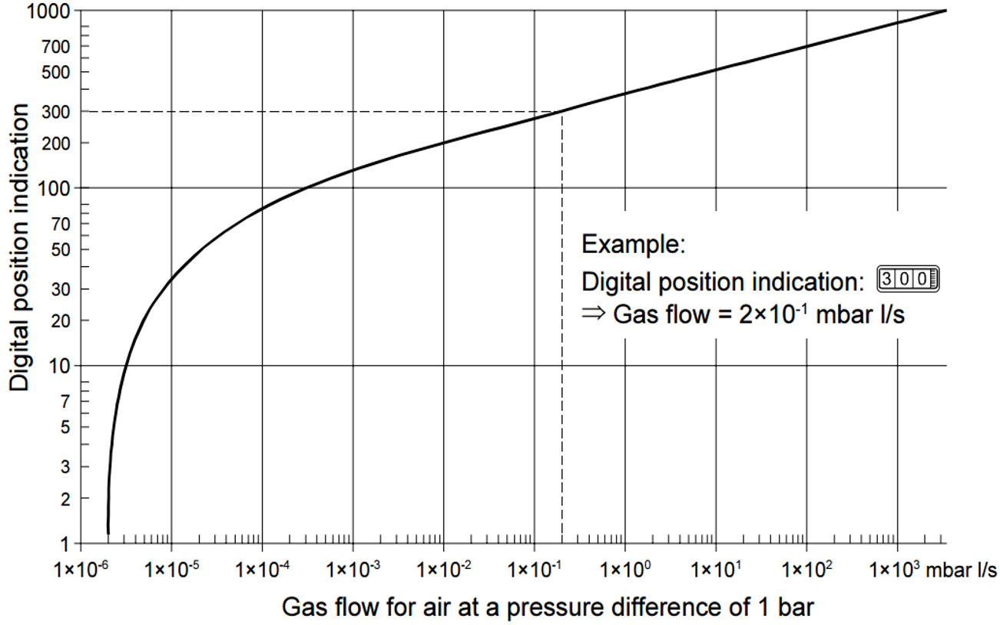

# 洩漏閥（Dosing Valve）點位與漏氣流量

漏氣測試記錄裡的 `DV=300` 之類，是洩漏閥（Dosing Valve）的**數位位置**，不是流量。本文說明每個位置大約漏進多少空氣，以及怎麼換算。

來源：個人筆記 `OES_LeakCheck/Dosing Valve Data Table and Formula.md` 與廠商曲線圖，整理於 2026-11-21。

## 曲線圖

這張圖的條件是**空氣、壓差 1 bar**。下表的數值是從曲線上讀出來的，只是近似值。只有「位置 300 → 2×10⁻¹ mbar·L/s」是圖上明確標出的範例點。

## 曲線近似表

| 數位位置 N | 流量 Q（mbar·L/s） | 流量（Torr·L/s） |
| ---: | ---: | ---: |
| 1 | 2.0×10⁻⁶ | 1.50×10⁻⁶ |
| 2 | 2.0×10⁻⁶ | 1.50×10⁻⁶ |
| 3 | 2.1×10⁻⁶ | 1.58×10⁻⁶ |
| 5 | 2.4×10⁻⁶ | 1.80×10⁻⁶ |
| 7 | 2.7×10⁻⁶ | 2.03×10⁻⁶ |
| 10 | 3.2×10⁻⁶ | 2.40×10⁻⁶ |
| 20 | 5.0×10⁻⁶ | 3.75×10⁻⁶ |
| 30 | 8.0×10⁻⁶ | 6.00×10⁻⁶ |
| 50 | 2.0×10⁻⁵ | 1.50×10⁻⁵ |
| 70 | 5.0×10⁻⁵ | 3.75×10⁻⁵ |
| 100 | 3.0×10⁻⁴ | 2.25×10⁻⁴ |
| 200 | 1.0×10⁻² | 7.50×10⁻³ |
| **300** | **2.0×10⁻¹**（圖上標示點） | **1.50×10⁻¹** |
| 500 | 1.0×10¹ | 7.50×10⁰ |
| 700 | 1.0×10² | 7.50×10¹ |
| 1000 | 約 3.0×10³ | 約 2.25×10³ |

單位換算：

- Q(Torr·L/s) = 0.750062 × Q(mbar·L/s)
- 1 sccm ≈ 0.016888 mbar·L/s，所以 Q(sccm) ≈ Q(mbar·L/s) / 0.016888

## 本 repo 測試用到的點位

| DV | Q（mbar·L/s） | Q（Torr·L/s） | Q（sccm） | 說明 |
| ---: | ---: | ---: | ---: | --- |
| 0 | 0 | 0 | 0 | 閥關閉，當作基準 |
| 50 | 2.0×10⁻⁵ | 1.5×10⁻⁵ | 0.0012 | 查表 |
| 200 | 1.0×10⁻² | 7.5×10⁻³ | 0.59 | 查表 |
| **300** | **0.20** | **0.15** | **11.8** | 圖上標示點，最可信 |
| 400 | ≈1.8 | ≈1.36 | ≈107 | 用 300–500 雙對數內插（a ≈ 7.66） |

這一段的曲線非常陡：每多開 100 格，流量大約變成 10–20 倍。所以 DV=200 和 DV=300 的漏氣量差了 20 倍，DV=400 又比 DV=300 多了大約 9 倍。11/19 的反應跟這個趨勢一致：DV=300 時 NO +30%，DV=400 時 NO +250%（見 [11/19–11/20 工作記錄](worklog-20261119-20261120.md)）。

## 內插公式

這條曲線既不是線性，也不是單一冪次，所以用上表做**雙對數內插**。設 N 落在相鄰兩點 (N₁, Q₁)、(N₂, Q₂) 之間：

log₁₀Q = log₁₀Q₁ + (log₁₀N − log₁₀N₁) / (log₁₀N₂ − log₁₀N₁) × (log₁₀Q₂ − log₁₀Q₁)

也可以寫成：

Q = Q₁ × (N / N₁)ᵃ，其中 a = ln(Q₂/Q₁) / ln(N₂/N₁)

**範例：位置 250。** 取 N₁=200、Q₁=0.01，N₂=300、Q₂=0.2，得到 a = ln(20)/ln(1.5) ≈ 7.39，Q₂₅₀ = 0.01 × 1.25^7.39 ≈ **5.2×10⁻² mbar·L/s**（≈ 3.1 sccm）。原圖本來就只適合約略讀值，所以這個結果也只是近似值。

## 壓差修正

曲線的基準是壓差 1 bar。入口是大氣（約 760 Torr），所以實際壓差是 760 − 腔體壓力：

| 腔體壓力 | ΔP | 修正係數 Q / Q_graph |
| --- | --- | --- |
| 500 mTorr | 759.5 Torr = 1.0126 bar | ≈ 1.013 |
| 5 Torr | 755 Torr = 1.0066 bar | ≈ 1.007 |
| 21 Torr（11/19 測試） | 739 Torr = 0.9853 bar | ≈ 0.985 |

這裡用的是簡化的線性修正，差異都在 ±1.5% 以內，直接用 Q_graph 就可以。而且在這麼大的壓力比下，閥口流量本來就幾乎不隨下游壓力改變。

### 範例：10 L 腔體、3 Torr

壓差 = 760 − 3 = 757 Torr = 1.0093 bar，修正係數約 ×1.009。以 sccm 計的漏氣量**與腔體體積無關**，體積只影響泵隔離時的 ROR（= 750.062 × Q / 10 L）。

| DV | 曲線 Q（mbar·L/s） | 3 Torr 修正後 Q | 漏氣量（sccm） | 泵隔離時 ROR |
| ---: | ---: | ---: | ---: | ---: |
| 100 | 3.0×10⁻⁴ | 3.03×10⁻⁴ | ≈ 0.018 | ≈ 0.023 mTorr/s |
| 200 | 1.0×10⁻² | 1.01×10⁻² | ≈ 0.60 | ≈ 0.76 mTorr/s |
| 300 | 0.20 | 0.202 | ≈ 12 | ≈ 15 mTorr/s |
| 400 | ≈ 1.81（內插） | ≈ 1.83 | ≈ 108 | ≈ 137 mTorr/s |
| 500 | 10 | 10.1 | ≈ 600 | ≈ 0.76 Torr/s |

只有 DV=300 是曲線上的標示點，其他是讀圖值，DV=400 是內插值，請當作量級看。泵開著時要看漏氣佔總進氣的比例：例如總進氣 1,550 sccm 時，DV=300 約佔 0.8%，DV=500 約佔 28%。

## 泵開著時：要看漏氣佔總流量的比例

漏氣測試時泵一直在抽，所以腔體壓力不會一直上升。OES 看到的是空氣在進氣中的**比例**，大約是 Q_leak / (Q_leak + 製程氣體總流量)。例如 DV=300 約 12 sccm。製程氣流量越大，同樣的 DV 被稀釋得越多。例如生產配方約 30 slm 時，DV=300 只佔約 0.04%。

## 泵隔離時：升壓率 ROR

只有在**腔體與泵隔離**時，才可以用 ROR = Q / V。

| 腔體 | 尺寸 | V | ROR（mTorr/s，Q 用 mbar·L/s） | DV=300 |
| --- | --- | --- | --- | --- |
| 方腔 | 120 × 120 × 30 cm | 432 L | 1.736 × Q | 0.347 mTorr/s |
| **圓柱腔（實驗機）** | 直徑 26 cm × 高 28 cm | 14.87 L | 50.44 × Q | 10.09 mTorr/s |

推導：ROR(mTorr/s) = 750.062 × Q / V。
