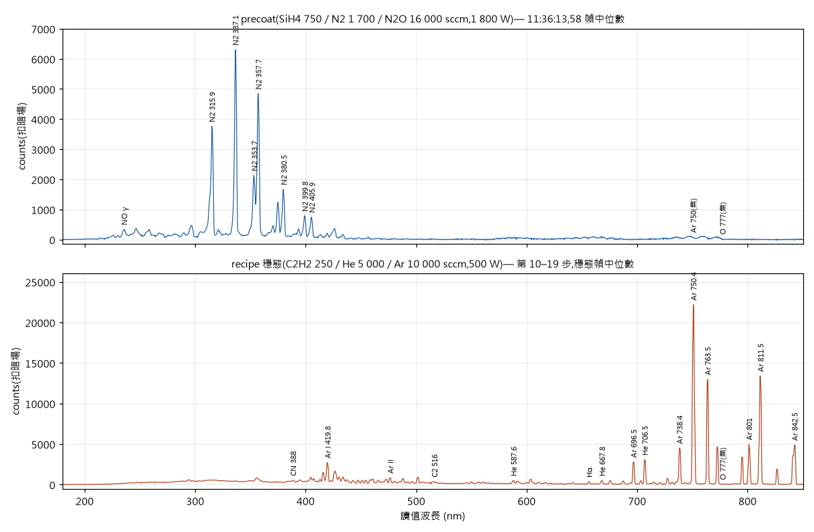
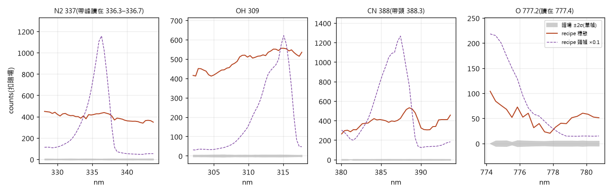
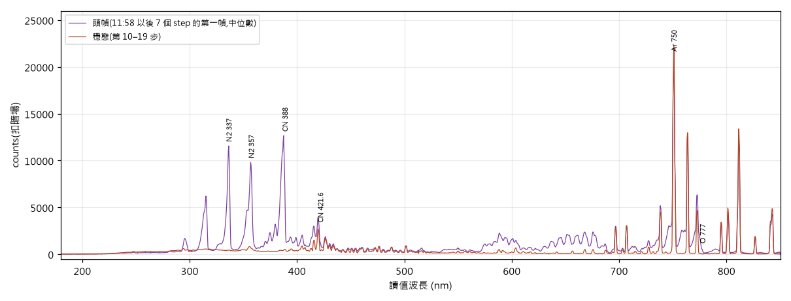

# 新生產機台 11/25 錄檔分析與測漏策略:precoat(SiH₄/N₂/N₂O)+ recipe(C₂H₂/He/Ar)

OES 在 2026-11-25 從 11/23–11/24 那台機台移到**另一台生產機台**。舊機台的最後一筆電漿是 10:40:56,
11:09:52 在新機台重新啟動(錄檔 PC 仍是 `DESKTOP-4JD00UD`,光譜儀 `OS361AC55036076`)。
**這一天沒有做漏氣測試**,下面全部是無漏氣的生產記錄。

客戶提供的製程條件(就是 11/23 文件裡更正過、當時「屬於另一台機台」的那份清單):

| 製程 | 氣體(sccm) | 總流量 | HF 功率 |
|---|---|---:|---:|
| precoat | SiH₄ 750、N₂ 1 700、N₂O 16 000 | 18 450 sccm | 1 800 W |
| recipe | C₂H₂ 250、He 5 000、Ar 10 000 | 15 250 sccm | 500 W |

資料:

| 來源 | 涵蓋 | 用途 |
|---|---|---|
| `C:\DualOES\202611\25` 全譜錄檔 28 筆 | 11:22–12:08 | 離線抽線(§1–§4) |
| `diag_DESKTOP-4JD00UD_cc03_20261125_120832.zip` | 11:09–12:08 | 系統日誌、`settings.json`、引擎 `P_Ratio`、SECS/EAP 日誌(§6) |

分析程式:`tools/analysis/20261125/step_stats.py`(`python3 -I`,與 11/23、11/24 的腳本同一套離線 peak-height 抽法);
圖 1–3 由 `plot_spectra.py` 產生(要 numpy / matplotlib,用 Windows 的 Python 跑)。
離線抽法不是引擎的 `LineIntensityExtractor`,絕對值不同;同一套抽法之內的相對變化可以比。

> **結論**
>
> 1. **precoat 不能拿來測漏。**光譜幾乎只有 N₂ 第二正帶(N₂ 337 約 5 000 counts),沒有 Ar,也看不到 O 777。
>    N₂ 1 700 + N₂O 16 000 sccm 的電漿裡,漏進來的空氣(78 % N₂、21 % O₂)不會改變任何看得到的東西。
>    引擎靠 Ar 750 的 plasma floor 本來就會把它當 NoPlasma 跳過;這是正確的,保持這樣。
> 2. **recipe 有兩個好用的漏氣指標**:
>    - **CN 388 / Ar 750**:CN 帶頭看得到(約 140 counts),背景來自腔體本身的氮,
>      precoat 之後 9 步內從 0.0091 降到 0.0064–0.0070,平台區 step 間 CV 3.0 %。
>    - **O 777**:recipe 沒有含氧氣體,穩態幀的 O 777 跟暗場一樣(40 ± 1.3 counts),**背景是零**。
>      但這一天**沒有任何含 O 的電漿可以證明 O 777 在這裡被激發得出來**(precoat 有 16 000 sccm N₂O 也看不到),
>      靈敏度完全要靠 DV 測。另外 777 nm 窗緊貼 N₂ 第一正帶(帶頭約 775 nm),漏進來的 N₂ 也會讓它上升(§3.2、圖 3)。
>    CN 的背景有 precoat 記憶效應、O 777 沒有,適合先當 `RequireTwoForAlarm` 的一對。
>    N₂ 337 在穩態幀落在雜訊裡(SNR 不足),只能 TrendOnly。
> 3. **每個 recipe step 頭尾都有含 N₂ / N₂O 的轉換段**:頭一幀 N₂ 337 3 000–10 200 counts、CN / Ar 是穩態的 20–200 倍、
>    580–800 nm 一整片 N₂ 第一正帶。引擎目前**會判定這一幀**(`P_Ratio` 12:05:39:N₂ 337 / Ar = 0.445,穩態 0.003)。
>    必須開分類器、把比值限定在 recipe,並把 `DecideAfterFrames` 設得超過轉換段(§5.2)。
> 4. **step 內 CN / Ar 會一路上升 +25–40 %**(其他線同時降 5–11 %,只有 CN 本身升 +17 %),
>    所以基準與判定一定要用同一段時間窗,逐幀判定的門檻不能太緊(§3.3、§5.4)。
> 5. **工具現在等於沒有保護**:取樣 `averageCount` 被改成 20(每幀 4 s,一個 step 只有 5–6 幀穩態);
>    12:04 擷取的 GR「Recipe 2」只有 NO 237 / Ar 一個基準,而 recipe 在 237 nm **沒有任何譜線**,
>    那個比值量的是連續光除以 Ar;N₂ 337 / Ar、N₂ 357 / Ar 都因 SNR 不足沒建到基準。
>    SECS 與 EAP 跟 11/24 一樣連不上(§6)。
> 6. 可偵測漏率**還不能算**:要等洩漏閥(DV)加量測試(§7)。以濃度看,recipe 15 250 sccm 是 cc03 生產配方的一半,
>    同樣的漏率稀釋只有一半;O 777 又是零背景。比 cc03 有希望,但 1 mTorr/min 級的規格是否做得到,仍要靠 DV 決定。

---

## 1. 時間線

| 時間 | 事件 | 錄檔 |
|---|---|---|
| 10:40:56 | 舊機台最後一筆電漿(`P_Ratio_1125000001.csv`) | — |
| 11:09:52 | App 在新機台啟動、11:10:36 連上光譜儀 | — |
| 11:18–11:29 | 調整取樣與觸發門檻(積分 100 / 200 ms、平均 5 / 20、觸發 p99 門檻 10、50、70、100、1 000) | 11:22–11:28 共 7 筆,**都是暗場**,門檻太低誤觸發 |
| 11:36:13–11:40:13 | **precoat**,電漿約 235 s | `P_OES1_1125113613` |
| 11:41:37 | 第一個 recipe step,**亮度只有後面的 27 %**(§2.3) | `P_OES1_1125114137` |
| 11:42:42–12:07:37 | recipe step × 19,每 77–81 s 一次 | 11:42:42 起 19 筆 |
| 12:04:24 | 擷取 GR「Recipe 2」(15 s,5 幀) | — |
| 12:08:32 | 取 diag 包 | — |

整段的取樣都是積分 200 ms、`averageCount` 20,**每幀 4.03 s**(11:22–11:28 的暗場是平均 5 / 每幀 1.1 s 與積分 100 ms)。

recipe step 有兩種長度:11:42–11:57 的 12 個每筆 11 幀(閘門開約 36 s),11:58 以後的 7 個每筆 10 幀(約 32 s)。
後者 Ar 750 低 6 %、N₂ 337 雜訊讀值低 20 %,CN / Ar 高約 3 %。是同一個 recipe 的兩種長度,還是兩個 recipe,要問客戶。

---

## 2. 兩種製程的光譜

### 2.1 precoat

穩態 58 幀(peak-height,扣暗場):

| 線 | counts | 備註 |
|---|---:|---|
| N₂ 337(帶峰讀在 336.3) | 4 870–5 250 | 235 s 內只漂 +1.7 % |
| N₂ 357、315、380、353 | 3 800、2 800、1 400、1 100 | 第二正帶 |
| NO γ 236 / 247 / 259 | 110–180 | 有,但弱 |
| SiH 414、Si 288 | 約 45、20 | 很弱 |
| Ar 750、He、Hα、**O 777** | 雜訊 | **N₂O 16 000 sccm 卻看不到 O 777** |

沒有 Ar 就沒有現成的 actinometer;而空氣進到這個電漿,N₂ 被 1 700 sccm N₂ 加上 N₂O 解離出來的氮蓋掉,O₂ 被 16 000 sccm N₂O 蓋掉。
**precoat 判定為不可測漏(NO-GO)。**N₂ 337 的絕對亮度很穩,可以當視窗透光率的趨勢(每次 precoat 一個點),不判漏。

### 2.2 recipe 穩態

recipe 的光譜以 Ar I(696–842 nm、415–434 nm)、Ar II(454–488 nm)、He(501.6、587.6、667.8、706.5)為主,
碳氫的線很弱,底下有一片紫外到藍光的寬連續光(380 nm 附近約 450 counts)。後 10 個 step 的穩態平均:

| 線 | counts | 單幀 sd | step 間 sd | 說明 |
|---|---:|---:|---:|---|
| Ar 750 | 20 800–22 300 | 3.4 % | — | 參考線;He 706 / Ar CV 1.0 % |
| Hα 656 | 289 | 5.2 | 1.7 | |
| C₂ 516 | 133 | 4.3 | 3.4 | |
| **CN 388** | **141** | 8.8 | **3.1** | 帶頭清楚,388.2–388.5 |
| N₂ 337 | 58 | 13.4 | 6.8 | **看不到峰**,讀值是連續光上的雜訊(暗場也讀 26) |
| OH 309 | 41 | 2.0 | 3.4 | 仍在下降(§3.1) |
| **O 777** | **40** | 2.4 | **1.3** | **= 暗場(40.1 ± 2.1)**,沒有 O |
| NO 237 | 40–55 | — | — | 沒有 NO γ 峰 |

`N2 357 / Ar750` 在 recipe 量到的是 355–360 nm 連續光的斜坡(862 → 465 counts),不是 N₂,**不能用**。

### 2.3 第一個 recipe step(11:41:37)

28 s,沒有頭尾轉換幀;Ar 750 只有 4 800–6 400(後面 step 的 27 %),He 706 / Ar 0.16、CN / Ar 0.06。
化學組成像 recipe,但亮度差 3.6 倍,可能是不同功率或不同流量的第一片 / 暖機步驟。只看到一次,要問客戶。

### 2.4 波長軸

Ar 750.39 讀在 750.8–750.9(+0.5)、He 706.52 讀在 706.8(+0.3)、Hα 656.28 讀在 656.5(+0.2)、
CN 388.34 讀在 388.5(+0.15)、Ar 811.53 讀在 811.5(0)。現有的 Ar +0.4 / O +0.2 修正和 `PeakSearchHalfWidthNm` 1 nm 涵蓋得了。
N₂ 337 在 precoat 的帶峰在 336.3–336.7(低解析度下第二正帶的峰落在帶頭 337.13 的紫外側),窗中心用 336.7。

---

## 3. recipe 的序列與 step 內變化

### 3.1 precoat 之後的位置衰減

穩態幀平均,位置 1 = 11:42:42(不含 §2.3 那個弱 step):

| 比值 | 位置 1 | 位置 19 | 19 / 1 | 後 10 步 CV | 相鄰 step 差 sd/√2 |
|---|---:|---:|---:|---:|---:|
| CN 388 / Ar 750 | 0.0091 | 0.0066 | 0.72 | 3.0 % | 2.6 % |
| CN 388 / Hα | 0.636 | 0.483 | 0.76 | 2.3 % | 2.0 % |
| OH 309 / Ar 750 | 0.0123 | 0.0018 | **0.15** | 6.2 % | 9.3 % |
| C₂ / Ar 750 | 0.0069 | 0.0063 | 0.90 | 1.5 % | 1.6 % |
| Hα / Ar 750 | 0.0143 | 0.0136 | 0.95 | 2.3 % | 0.9 % |
| He 706 / Ar 750 | 0.1449 | 0.1435 | 0.99 | 1.0 % | 0.3 % |

CN / Ar:`0.0091 0.0081 0.0075 0.0074 0.0073 0.0070 0.0069 0.0067 0.0064 | 0.0064 0.0064 0.0068 0.0070 0.0069 0.0068 0.0068 0.0065 0.0065 0.0066`,
第 9 步之後進入平台。OH / Ar 一路降到 1/7,到最後還沒停。

這跟 11/24 舊機台「含氮指標隨 D 段之後的位置遞減」是同一類現象:**precoat 帶進來的 N、O(H₂O)被後面的 recipe 一步一步清掉**。
差別是這次只錄到一個 precoat,**同一位置是否批批重現還沒驗證**。

### 3.2 每個 step 頭尾的轉換幀

19 個 step 的頭一幀(有幾個連第二幀)都是 N₂ 337 3 000–10 200、CN 388 2 600–5 200(CN / Ar 0.14–1.3,穩態 0.0066),
580–800 nm 冒出一整片 N₂ 第一正帶,Hα 被它扣成負值;最後一到兩幀 Ar 掉下去、N₂ 337 回升到 150–830(圖 2)。
**step 開始與結束時腔體裡有 N₂**,而且和 C₂H₂ 同時在電漿裡(才會有那麼亮的 CN)。
頭幀在 777.4 nm **沒有 O 峰**:離線抽線在那裡讀到的 200–540 counts 是 N₂ 第一正帶從 775 nm 往長波長拖下來的斜坡(圖 3 右),
所以從光譜看不出轉換段有沒有 N₂O。

4 s 一幀分不出轉換段多長;頭一幀的 CN / Ar 在 40 s 長度的 step 裡有時連第二幀都還是穩態的 5–9 倍,
所以轉換段可能長達 4–8 s。**完整的 recipe step 表(含 N₂ / N₂O 的前後步驟)要問客戶。**

### 3.3 step 內的上升

穩態幀從第一幀到最後一幀:Ar 750 ×0.92、He 706 ×0.91、C₂ ×0.92、Hα ×0.96,**CN 388 ×1.17**。
所以 CN 除以任何參考線,在一個 step 裡都會升 25–40 %(例:`5.94 6.52 6.92 7.09 7.58` ×10⁻³)。
可能是腔壁或剛鍍上的膜裡的 N 被慢慢釋放。後果:

- 基準與判定要取**相對開段時間固定的同一段窗**(Batch layer 的作法,§5.5)。
- GR 擷取窗若只蓋住 step 的前半或後半,基準就差 10–20 %;引擎的 `sigma` 會被這個斜坡撐大。
- 逐幀判定的 `AlarmFactor` 若用 1.12,step 後段可能單獨越線。

---

## 4. 靈敏度:能拿什麼抓空氣

| | precoat | recipe |
|---|---|---|
| 總流量 | 18 450 sccm | 15 250 sccm |
| 1 sccm 空氣的濃度 | 54 ppm | 66 ppm(N₂ 51、O₂ 14) |
| N 的背景 | N₂ 1 700 + N₂O 16 000 sccm | 腔體記憶效應(CN 140 counts,平台) |
| O 的背景 | N₂O 16 000 sccm | **零**(O 777 = 暗場) |
| actinometer | 無 Ar | Ar 750 |
| 判定 | **NO-GO** | 可以,靈敏度待 DV 量 |

recipe 的偵測下限(後 10 步、單一 step 平均):

| 指標 | step 間 sd | 3 σ | 6 σ |
|---|---:|---:|---:|
| CN 388 | 3.1 counts(2.2 %) | +9 counts | +19 counts(+13 %) |
| O 777 | 1.3 counts | +4 counts | +8 counts |

要換成漏率,得知道「多少 sccm 空氣讓 CN、O 777 升幾 counts」。這張表只能用 DV 量。

規格的對照:腔體容積 V、升壓率 1 mTorr/min 對應的漏率是 `V × 1×10⁻³ Torr/min`;
若 V = 50 L,就是 0.066 sccm,在 recipe 裡只有 **4 ppm 空氣**。
cc03 生產配方(30 slm)在 09 月量到的可偵測濃度是 54–126 ppm(`production-flow-30slm-no-go` 的結論,用的是 N₂ / CO 那組比值),
換到這裡是 0.8–1.9 sccm。這台的 O 777 零背景、CN 對 N 敏感,有機會好很多,但**不能先假設**。

---

## 5. 測漏策略

### 5.1 取樣

`averageCount` 20 → **5**(每幀約 1.1 s)。

- 硬體平均是平均不是加總,單幀的 counts 水準不變(Ar 750 單幀最高 26 000),只改變每秒幾幀。
- 4 s 一幀時,一個 32 s 的 step 只剩 5 幀穩態,頭尾轉換段跟穩態混在同一幀裡,分類器與 GR 都沒辦法避開。
- 平滑交給引擎的 `EmaTauSeconds`,不要靠硬體平均。

改完後用現行 recipe **重新擷取 GR**(引擎會因取樣不同發出 `LeakMonitorAcquisitionMismatch`)。

### 5.2 分類器:把比值限定在 recipe

開 `ProcessClassifier`,兩條規則(兩邊都用 `RawMean`,±0.5 nm,永遠是正數,不會因扣連續光變負而讓規則無法評估):

| 順序 | 規則 | 類別 | 量到的值 |
|---|---|---|---|
| 1 | `RawMean N₂ 336.7 / RawMean Ar 750.8 > 5` | `Precoat` | precoat 48–56 |
| 2 | `RawMean N₂ 336.7 / RawMean Ar 750.8 < 0.5` | `Recipe` | recipe 穩態 0.021–0.035(中位 0.024);§2.3 的弱 step 0.023–0.035 |
| — | fallback 空白 | `Unknown`(不判定) | 頭尾轉換幀 0.03–0.95 |

- **`DecideAfterFrames` = 10**(取樣改成每幀 1.1 s 之後約 11 s)。引擎在判定類別之前**不判定**限定了類別的比值,
  所以這個值同時就是「跳過開頭轉換段」的長度;§3.2 估的轉換段最長 8 s。
- 所有 Alarm / TrendOnly 比值的 `ProcessClass` 設 `Recipe`。不設的比值會在每個 step 頭一幀被判定(§6 那個 0.445)。
- §2.3 那種弱 step:若客戶確認每次 precoat 後都有,可以給 `Recipe` 類別設 `PlasmaThreshold`
  (觸發指標 p99:弱 step 1 470–1 730、正常 step 5 000–6 700,取 3 000),它就不會被判定。先觀察。
- 換取樣之後,觸發指標的數值不變(平均不是加總),但**上機後要用 Replay 跑一次今天的錄檔確認分類與判定不在頭幀觸發**。

### 5.3 比值組(全部 `ProcessClass = Recipe`)

| 比值 | 分子 | 分母 | 角色 | 理由 |
|---|---|---|---|---|
| CN / Ar | CN 388.4 `PeakHeight` ±0.5,搜尋 ±1 | Ar 750.8 `Integral` ±1 | **Alarm** | 對 N 最敏感,背景穩定 |
| O / Ar | O 777.4 **`RawMean`** ±0.5 | Ar 750.8 `Integral` ±1 | **Alarm** | 零背景;`RawMean` 讓引擎用 σ 判定、SNR 門檻對分子不作用,不然 GR 會像今天的 N₂ 337 一樣因 SNR 不足被丟掉 |
| N₂ / Ar | N₂ 336.7 `RawMean` ±0.5 | Ar 750.8 `Integral` ±1 | TrendOnly | 穩態看不到峰,大漏才會出現 |
| OH / Ar | OH 309.2 `PeakHeight` ±0.5 | Ar 750.8 `Integral` ±1 | TrendOnly | 水氣 / 記憶效應,precoat 後 19 步降到 1/7,當 Alarm 會誤報 |
| CN / Hα | CN 388.4 | Hα 656.4 | TrendOnly | 相鄰 step 差最小(2.0 %),拿來對照 CN / Ar |

`RequireTwoForAlarm` 保持開啟:CN 有 precoat 記憶效應(位置 1–4 高 12–38 %),O 777 沒有,
兩個一起越線才 Alarm,precoat 後頭幾步的 CN 單獨偏高不會變成整體 Alarm。
注意這一對**不是 N 與 O 各一個**:O 777 的 `RawMean` 窗也會吃到 N₂ 第一正帶,漏氣時兩者都可能因 N₂ 而動。
DV 測試時要看 777 nm 是長出一根峰(O)還是整片斜坡抬高(N₂),再決定 O 777 用 `RawMean` 還是 `PeakHeight` + `MinSnr` 0。

刪掉 `NO 237 / Ar750`(recipe 237 nm 沒有線)與 `N2 357 / Ar750`(§2.2 的斜坡);
`N2 337 / Ar750` 改成上表的 `RawMean` TrendOnly。

### 5.4 Golden Run 與門檻

- **擷取位置:precoat 之後第 10 步以後**的 recipe step(平台區)。用 Baseline Builder 從錄檔選 5 個以上的平台 step 合併,
  不要用 Live 15 s(按下的時間點決定落在 step 的哪一段,§3.3)。
- §1 的兩種 step 長度:平台區 CN / Ar 差約 3 %,先共用一個 GR;客戶若說是兩個 recipe,再分兩個類別、兩個 GR。
- 門檻先放寬,DV 測試後再收:
  - CN / Ar:`WarnFactor` 1.2、`AlarmFactor` 1.3(§3.3 的 step 內斜坡 + 位置 1–4 的記憶效應)。
  - O / Ar(`RawMean`,用 σ):`SigmaWarn` 3、`SigmaAlarm` 6。
  - `ConfirmSeconds` 15 不變(轉換幀與尾幀只有 2–4 s)。
- 依位置 GR(issue #135)做出來之後,precoat 後第 1–9 步也能用自己的基準判定。

### 5.5 Batch layer

`BatchStartClass = Precoat`、`BatchStartMinDurationSeconds = 120`(precoat 235 s):每次 precoat 開一批,
批次取樣點是**每批第一個完整的 recipe step**、開段後 10–30 s 的中位數。
這是記憶效應最重的位置(CN / Ar 0.0091、OH / Ar 0.0123),但只要每批的 precoat 一樣,同一位置批批可比 —— 11/24 舊機台同位置的批間 CV 是 0.5–2.4 %。
32 s 的 step 在 30 s 已碰到尾幀;取樣改成每幀 1.1 s 之後,`WindowEndSeconds` 建議改 **24**。
`batchGapSeconds` 240 照舊(step 間隔 77–81 s)。

### 5.6 precoat

不判漏。N₂ 337 絕對值(或 N₂ 337 / N₂ 357)每次 precoat 記一個點,當作視窗透光率的趨勢。

---

## 6. 工具目前的設定與連線(diag 包,12:08:32)

| 項目 | 現況 | 處理 |
|---|---|---|
| 取樣 | 積分 200 ms、`averageCount` **20**(每幀 4 s) | 改 5(§5.1) |
| GR | 「Recipe 2」12:04:24 擷取 15 s、**5 個樣本**,只有 `NO 237 / Ar750` 有基準(mean 0.00576、σ 1.0×10⁻⁴);`N2 337 / Ar750`、`N2 357 / Ar750` 因 SNR < 5 被丟掉 | 換比值組後重建(§5.3、§5.4)。注意:10/29 的「Recipe 2」**已被覆寫** |
| 比值組 | 6 個比值,3 個停用;都沒有 `ProcessClass` | §5.3 |
| 分類器 | 停用 | §5.2 |
| 頭幀 | 引擎有判定:12:05:39 `N2 337 / Ar750` = 0.445、`N2 357 / Ar750` = 0.306(穩態 0.003 / 0.007) | §5.2 |
| precoat | Ar floor 6 902 → NoPlasma,不判定(正確) | 保持 |
| Batch | 開,無 `BatchStartClass`,窗 10–30 s | §5.5 |
| SECS | 失敗:`在其上下文中,该请求的地址无效` —— 本機沒有 10.2.81.83 這個位址,與 11/23 15:13 起相同 | 新機台的 IP / port / chamber code 要重新給 |
| EAP | 10.2.3.120:20347 連不上 | 同上 |
| 資料夾 | `D:\OES_LEAK_DATA` 21.49 GB,超過 20 GB 上限,能壓縮的都壓了 | 把舊的封存檔搬走 |
| chamber code | 3(舊機台的值) | 問新機台的 code |

11:22–11:28 那 7 筆暗場錄檔是門檻設到 10–100 時誤觸發的,可以刪。

---

## 7. DV 加量測試

前提:§5.1–§5.3 已上機,Replay 確認頭幀不判定。

1. 等 precoat 之後**第 10 步以後**再開 DV,每個量連續 **至少 3 個 recipe step**,關閉後再看 3 個 step 的恢復。
   不要跨過 precoat(precoat 看不到,也會把 DV 期間的記憶效應攪進來)。
2. 先用大的量確認哪些線有反應,再往下:

   | DV | 空氣(sccm) | recipe 中的濃度 | 目的 |
   |---:|---:|---:|---|
   | 300 | 11.8 | 775 ppm | 確認 CN、O 777、N₂ 337、OH 哪些有反應、反應多大 |
   | 250 | ≈ 2.6(200–300 對數內插) | ≈ 170 ppm | 靈敏度斜率 |
   | 200 | 0.59 | 39 ppm | 接近可偵測下限? |

   DV 換算是實驗機那顆閥的表(`dosing-valve-reference-zh-TW.md`),這台若用不同的閥或 MFC,換成對應的 sccm。
3. 每個量記下 CN、O 777 在固定窗(開段後 11–24 s)的增量,除以 §4 的 step 間 sd,得到每 sccm 幾 σ,
   再用腔體容積換算成 mTorr/min,對規格判 GO / NO-GO。
4. 同時看:777 nm 是長出 O 峰還是 N₂ 第一正帶的斜坡;O 777 是否線性上升(C₂H₂ 會把 O 吃成 CO,O 777 可能不線性,甚至完全不出現);
   CN 的增量是否也出現在 step 前段(記憶效應是後段升,漏氣應該整段一起升)。
5. 結果決定:Alarm 對用 CN + O 還是換成 CN + N₂;門檻收到多緊;是否需要依位置 GR。

---

## 8. 回問客戶

1. **recipe 的完整 step 表**:每個 step 開頭與結尾看到的 N₂ / N₂O 是哪個步驟(預處理、purge、穩壓)?時間多長?
2. 11:41:37 那個亮度只有 27 % 的第一個 recipe step 是什麼?每次 precoat 後都會有嗎?
3. 兩種 step 長度(約 36 s 與 32 s)是同一個 recipe 嗎?
4. 一次 precoat 之後跑幾個 recipe?每 77–81 s 一個 step 是一片晶圓一次,還是多站式的一站?
5. 腔體容積、製程壓力、漏率規格(mTorr/min 或 mbar·L/s)。
6. 這台有沒有洩漏閥 / 可以加空氣或 N₂ 的管路?主機台的 Auto Leak check 結果能不能給我們對照?
7. 新機台的 SECS 位址、port、chamber code 與 EAP 位址。
