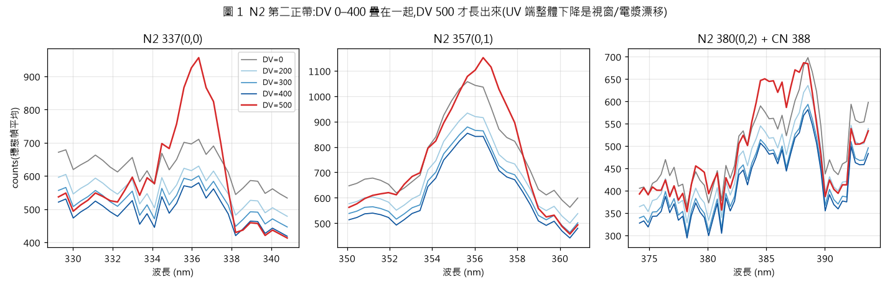
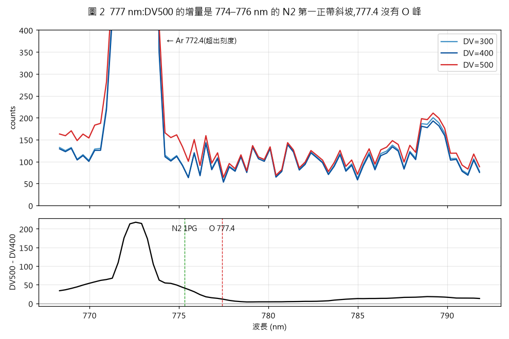
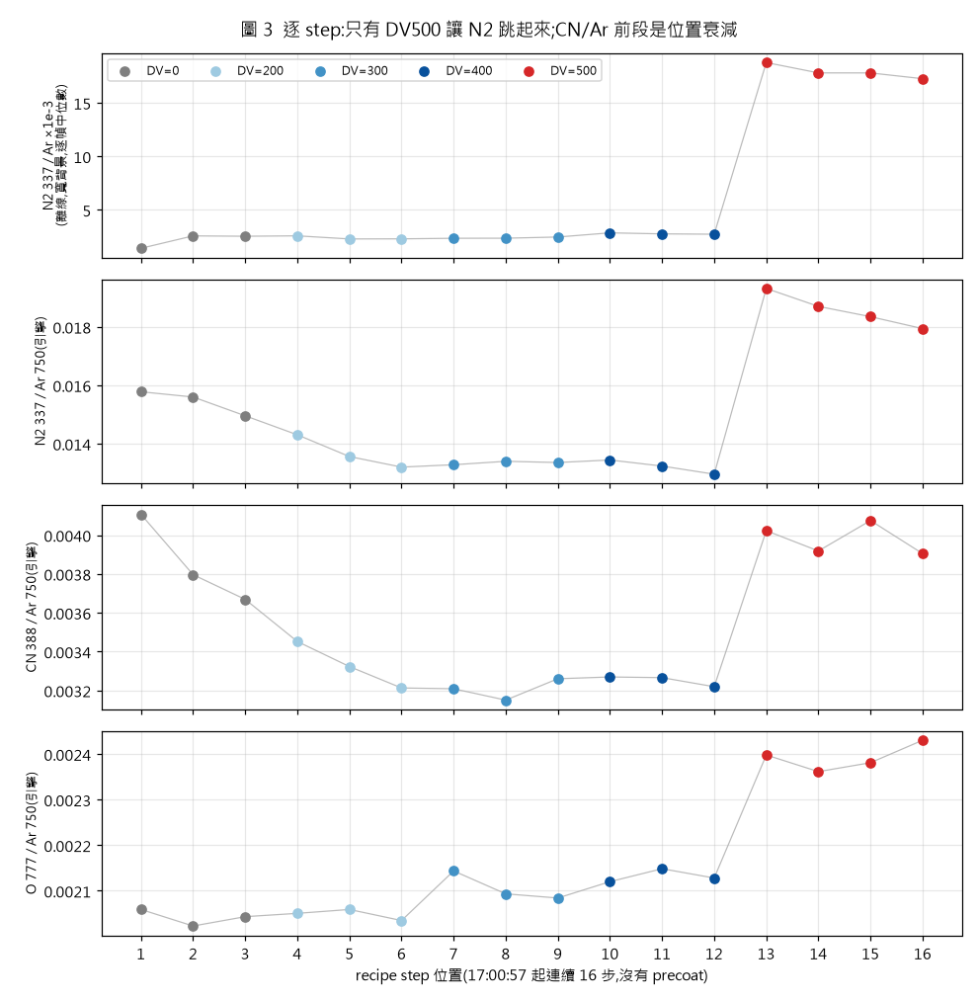

# 新生產機台 11/26 洩漏閥(DV)加量測試:recipe(C₂H₂/He/Ar)上 DV 0 → 500

2026-11-26 17:00:57 起,在 11/25 那台新生產機台(precoat SiH₄/N₂/N₂O + recipe C₂H₂/He/Ar,
見 `production-20261125-precoat-recipe-leak-strategy-zh-TW.md`,PR #138)的 recipe 上,
用洩漏閥把空氣加進腔體,DV 依序 0、200、300、400、500,每個點位 3 個 recipe step(DV 500 多一個)。

資料:

| 來源 | 涵蓋 | 用途 |
|---|---|---|
| `C:\DualOES\202611\26` 全譜錄檔 16 筆 + 每筆的 `P_<時間>.notes.txt`(現場標的 DV) | 17:00:57–17:32:26 | 離線抽線(§2–§4) |
| 同資料夾 `OES.txt`(現場紀錄,含客戶量的 ROR) | — | 流量換算(§4) |
| `diag_DESKTOP-4JD00UD_cc03_20261126_175656.zip` | 15:22–17:56 | 系統日誌、`settings.json`、引擎 `P_Ratio`(§3、§5) |

分析程式:`tools/analysis/20261126/dv_stats.py`(`python3 -I`,與 11/25 `step_stats.py` 同一套離線 peak-height),
圖 1–3 由 `plot_dv.py` 產生(要 numpy / matplotlib,用 Windows 的 `py -3.13` 跑)。
離線抽法不是引擎的 `LineIntensityExtractor`,絕對值不同;同一套抽法之內的相對變化可以比。
§3 另外列引擎自己在 `P_Ratio` 裡算的比值。

> **結論**
>
> 1. **只有 DV = 500 看得到。**N₂ 第二正帶(337、357、380、315 nm)整組長出來,
>    N₂ 337 / Ar 從 3.3–3.7 跳到 19(×10⁻³,寬背景 peak-height),四個 step 都一樣,整段 step 都平穩;
>    相對於 DV 0–400 的 step 間變化(sd ≈ 0.2)大約 70σ。
> 2. **DV = 200、300、400 都看不到。**DV 400 的 N₂ 337 / Ar 是 3.60–3.71,落在 DV 0 / 200 的範圍(3.4–4.0)內;
>    客戶量的 ROR 在 DV 400 已經是 **0.5 Torr/min**。
> 3. **777 nm 沒有 O 峰,NO γ 帶也沒有反應。**DV 500 時 777 nm 窗的上升是 774–776 nm N₂ 第一正帶的斜坡(圖 2);
>    NO 237 / 247 / 259 反而一路往下。這個 C₂H₂ 電漿裡**看不到漏進來的氧**,
>    11/25 寄望的「O 777 零背景指標」不成立,只能靠 N₂(和 CN)。
> 4. **偵測下限約 0.3 Torr/min(≈ 25 sccm 空氣),不確定度約 ×3。**DV 500 本身沒有量 ROR,流量用閥的表推;
>    若是 mTorr/min 級的規格,差了兩到三個數量級 —— **對 mTorr/min 規格 NO-GO**。
> 5. **測試當下工具沒有判定任何東西。**16 次 Golden Run 擷取全部在 16:01–16:51 沒有 recipe 電漿時按下、沒有一次留下基準,
>    作用中的 GR 跟現在的比值組對不上,引擎從頭到尾 `Idle`。11/25 建議的分類器與 Recipe 限定也還沒上機。
> 6. 要讓 DV 500 這種量級報警,Alarm 對要換成 **N₂ 337 PeakHeight(寬背景)/ Ar**;
>    引擎現在的 N₂ 337 是 RawMean,同樣的漏只看到 +41 %。

---

## 1. 時間線

現場紀錄(`OES.txt`):

| DV | 時間 | step 數 | 客戶量的 ROR |
|---:|---|---:|---:|
| 0 | 17:01–17:04 | 3 | — |
| 200 | 17:07–17:10 | 3 | 0.007 Torr/min |
| 300 | 17:13–17:17 | 3 | 0.14 Torr/min |
| 400 | 17:18–17:21 | 3 | 0.5 Torr/min |
| 500 | 17:23–17:26 | 3 | (沒量) |
| 500 | 17:31–17:32 | 1 | (沒量) |

製程順序記為 `precoat-undcoat-dep-index 180°-dep-n2(5000+9500 >> 0.8 T)-END`。

- 測試期間**沒有 precoat**(上一筆 precoat 錄檔是 16:21),16 個 recipe step 是 precoat 之後連續的位置 1–16。
  DV 0 落在位置 1–3,CN / OH 還在 precoat 之後的衰減段(11/25 文件 §3.1),比較 DV 效應時以位置 7 以後為主。
- 取樣:積分 200 ms、`averageCount` 5,每幀 1.1 s,一個 step 45–46 幀、穩態約 29 幀。
- DV 沒有關回 0 再看恢復。17:54:35 那筆錄檔是 575 nm 附近的寬帶連續光(不是電漿,Ar 750 只有 43 counts),
  觸發是外部光源造成的。

## 2. 光譜:DV 500 長出 N₂ 第二正帶,其餘不動

每個 DV 的平均穩態譜(圖 1):

- **DV 0、200、300、400 的形狀完全一樣**,只是 UV 端整體一路往下(見 §2.2)。
- **DV 500**:N₂ 337(0,0)、357(0,1)、380(0,2)帶頭都冒出來,315 / 313 nm 的 Δv = +1 序列也是。
  337 nm 帶頭比 DV 400 多約 310 counts。
- CN 388 帶尾(384–388 nm)整片多約 70 counts,但 388 帶頭本身沒有比兩旁突出(§3)。

### 2.1 777 nm 與 NO γ

DV 500 − DV 400 在 772.4 nm 是 Ar 線(Ar 本身回升 2–3 %);774–776 nm 有一段 +40–50 counts 的寬坡(N₂ 第一正帶),
到 777.4 nm 只剩 +9,而且是平滑往下,**沒有 O 777 的峰形**。
NO γ(237、247、259 nm)在 DV 500 是 −10 到 −19 counts,跟 UV 端整體下降同一個趨勢,沒有任何 NO 帶出現。

recipe 有 250 sccm C₂H₂,漏進來的 O 很可能都變成 CO / H₂O,不留在激發得到的 O 原子上。
這跟 11/19 實驗機(DV 300 時 NO +30 %)完全不同 —— 那台沒有碳氫氣體。

### 2.2 不是漏氣造成的漂移

- UV 連續光 30 分鐘內一路降:230 nm 從 206 → 150 counts(−27 %),330 nm −20 %。DV 500 時沒有停止。
  視窗沉積或電漿 UV 輸出漂移,與 DV 無關。
- Ar 750 在 DV 300–400 期間降 8 %(25 150 → 23 000),DV 500 又回到 24 000;He 706、Hα 同步。
  如果是漏氣造成,DV 500 應該降得更多,所以這也是電漿本身的漂移。
  **以 Ar 為分母的比值在這段會被抬高 5–8 %**:引擎的 O 777 / Ar 在 DV 300–400 微升 +2–4 %,就是這個原因,不是 O。

## 3. 逐 step 的比值

`dv_stats.py` 輸出(穩態幀平均;離線 peak-height ÷ Ar 750,×10⁻³)。
「N₂ 寬背景」= 335.5–337.2 nm 最大值,扣 331–332.5 與 338.3–339.7 nm 的平均。

| 位置 | DV | N₂ 337 / Ar(寬背景) | N₂ 337 / Ar(±1.5 nm 背景) | CN 388 / Ar | OH 309 / Ar | O 777 / Ar | NO 237 / Ar |
|---:|---|---:|---:|---:|---:|---:|---:|
| 1 | 0 | 1.80 | 2.15 | 7.57 | 13.37 | 1.56 | 2.44 |
| 2 | 0 | 3.52 | 3.27 | 6.38 | 3.91 | 1.55 | 2.37 |
| 3 | 0 | 3.51 | 3.20 | 5.87 | 2.59 | 1.55 | 2.35 |
| 4 | 200 | 3.42 | 3.14 | 5.59 | 2.07 | 1.55 | 2.21 |
| 5 | 200 | 3.98 | 3.51 | 5.40 | 1.74 | 1.58 | 2.20 |
| 6 | 200 | 3.70 | 3.34 | 5.22 | 1.67 | 1.54 | 2.10 |
| 7 | 300 | 3.31 | 3.04 | 5.08 | 1.84 | 1.62 | 2.06 |
| 8 | 300 | 3.27 | 3.10 | 5.02 | 1.66 | 1.60 | 2.14 |
| 9 | 300 | 3.29 | 3.08 | 5.06 | 1.63 | 1.65 | 2.10 |
| 10 | 400 | 3.70 | 3.38 | 5.21 | 1.61 | 1.74 | 2.05 |
| 11 | 400 | 3.71 | 3.33 | 5.18 | 1.66 | 1.75 | 2.04 |
| 12 | 400 | 3.60 | 3.24 | 5.14 | 1.66 | 1.70 | 2.02 |
| 13 | **500** | **19.86** | **14.28** | 5.01 | 2.09 | 2.03 | 1.89 |
| 14 | **500** | **18.99** | **13.68** | 4.93 | 2.37 | 1.97 | 1.82 |
| 15 | **500** | **19.19** | **13.81** | 5.14 | 2.39 | 2.03 | 1.80 |
| 16 | **500** | **18.63** | **13.36** | 5.05 | 2.22 | 2.04 | 1.77 |

引擎 `P_Ratio`(引擎自己的取線,開段後 12–40 s 平均;整段 `OverallState` 都是 `Idle`):

| DV | CN 388 / Ar | O 777 / Ar(RawMean) | N₂ 337 / Ar(RawMean) | OH 309 / Ar | CN 388 / H 656 |
|---|---:|---:|---:|---:|---:|
| 300(3 步) | 0.00315–0.00326 | 0.00208–0.00214 | 0.01328–0.01340 | 0.00111–0.00131 | 0.457–0.469 |
| 400(3 步) | 0.00322–0.00327 | 0.00212–0.00215 | 0.01295–0.01344 | 0.00102–0.00106 | 0.443–0.463 |
| 500(4 步) | 0.00390–0.00407 | 0.00236–0.00243 | 0.01794–0.01931 | 0.00074–0.00111 | 0.614–0.648 |
| DV 500 ÷ DV 400 | **+24 %** | +12 % | **+41 %** | — | **+38 %** |

讀法:

- **N₂ 337 是唯一明確的指標。**寬背景 peak-height 從 3.3–3.7 → 19(約 ×5.5),±1.5 nm 背景只有 ×4.3 ——
  漏氣時 N₂ 帶兩翼也升,貼身背景會扣掉一部分訊號。引擎的 RawMean 把 600 counts 的連續光底也算進去,只剩 +41 %。
- **CN 有反應,但取決於取線。**引擎的 CN(PeakHeight,背景在 383.8–385.6 / 391.0–392.8 nm)+24 %;
  離線的 ±0.8 nm 帶頭扣 ±1.5 nm 兩旁就看不到,因為漏氣讓 384–388 nm 整片帶尾一起升。
  CN 還有 precoat 之後的位置衰減(位置 1 → 7 從 7.6 降到 5.1)與 step 內上升(11/25 文件 §3.3),當 Alarm 要搭配位置平台 GR。
- **OH 309 / Ar 在 DV 500 的 +35 % 大半是 N₂ 第二正帶 Δv = +1 序列(311–316 nm)滲進 OH 窗**,不是 OH。
- **O 777 / Ar 的上升是分母與 N₂ 第一正帶**(§2.1、§2.2),不能當 O 指標。
- 每個 step 頭尾的 N₂ 轉換幀還在:頭兩幀 N₂ 337 / Ar 約 1 400–1 900、往後 10 幀才衰減到穩態(`dv_stats.py` 逐幀段)。
  DV 500 的 step 從第 7 幀起就平在 18–20,跟轉換段的尾巴分得開。

## 4. 靈敏度

### 4.1 流量換算

洩漏閥的表(`dosing-valve-reference-zh-TW.md`)與客戶量的 ROR 比對:

| DV | 閥表 Q(Torr·L/s) | 客戶 ROR | 推得容積 V = Q ÷ ROR | 採用的空氣流量 | 佔 recipe 15 250 sccm |
|---:|---:|---:|---:|---:|---:|
| 200 | 7.5 × 10⁻³ | 0.007 Torr/min | 64 L | 0.59 sccm | 39 ppm |
| 300 | 0.15 | 0.14 Torr/min | 64 L | 11.8 sccm | 775 ppm |
| 400 | (內插 1.36) | 0.5 Torr/min | — | **≈ 42 sccm**(用 V = 64 L 由 ROR 反推) | 0.28 % |
| 500 | 7.5(表上的點) | 沒量 | — | **≈ 590 sccm**(閥表) | 3.9 % |

DV 200 與 DV 300 兩點各自推出的腔體容積都是 64 L,所以閥表在這兩點可信;
DV 400 的實測只有表上內插值(107 sccm)的 40 %,**DV 500 的 590 sccm 也可能高估**(差不多倍數的話約 240 sccm)。

### 4.2 偵測下限

- 反應:DV 500 讓 N₂ 337 / Ar(寬背景)多 +15.6(×10⁻³)。
- 雜訊:位置 2–12(DV 0–400)的 step 間 sd ≈ 0.22;3σ ≈ 0.66。
- 若反應與流量成正比:3σ ≈ 0.66 / 15.6 × 590 ≈ **25 sccm**;以 DV 500 = 240 sccm 計則約 10 sccm。
- 換成 64 L 腔體的 ROR:25 sccm ≈ 0.32 Torr·L/s → **≈ 0.3 Torr/min**;10 sccm → ≈ 0.12 Torr/min。

DV 400(42 sccm)按比例應該 +1.1,實際是 0 到 +0.4(跟 DV 0–200 比是 0,跟 DV 300 比是 +0.4)。
比例推算稍高於觀察,但只差 3σ 左右,不能確定反應是否線性 —— 要 DV 450 或 DV 500 的 ROR 才分得出來。

**結論**:在這個 recipe 上,OES 抓得到的漏氣大約是 **0.1–0.3 Torr/min 以上**,
DV 400(0.5 Torr/min)理論上該在邊緣,實際沒有看出來。如果規格是 mTorr/min 級,這條路 NO-GO。

## 5. 工具在測試當下的狀態(diag 包,17:56:56)

| 項目 | 狀態 |
|---|---|
| Golden Run | 16:01–16:51 共 **16 次擷取**(「Recipe」、「Recipe 1」「2」「3」),當時腔體沒有電漿或只有 precoat:15 次是 `GoldenRunRatioDropped` × 5 → `GoldenRunEmpty`(丟棄),16:05:49 那次在光譜儀連上之前、沒有結果。DV 測試期間沒有再擷取。 |
| 作用中的 GR | 「Recipe 1」(10/29),只有一個 key `R_e97c9ee6` 的基準,跟現在的 5 個比值都對不上 → 引擎 17:00–17:32 全程 `Idle`。 |
| 比值組 | CN 388 / Ar(Alarm)、O 777 / Ar RawMean(Alarm)、N₂ 337 / Ar RawMean、OH 309 / Ar、CN 388 / H 656(TrendOnly);`processClass` 全空、`stepJudging` 全關。 |
| 分類器 | `processClassifier.enabled = false`(11/25 文件 §5.2 的設定還沒上機) |
| 取樣 | 積分 200 ms、`averageCount` 5(已照 11/25 建議改回) |
| SECS | 啟動 16 次都失敗:`SocketException`「該請求的地址無效」—— 這台 PC 沒有 10.2.81.83 這個 IP。 |
| EAP | 10.2.3.120:20347 連不上(17 次) |
| 資料夾 | 21.25 GB,超過 20 GB 上限(`DataRetentionOverCap`) |

即使當時有一個在 recipe 穩態擷取的 GR,用現在的比值組:
CN / Ar +24 % 只到 Warning(×1.2),O 777 的 +12 % 不到 σ 門檻,`RequireTwoForAlarm` → **DV 500 也不會 Alarm**。

## 6. 建議

1. **Alarm 對改成 N₂ 337 PeakHeight / Ar + CN 388 / Ar**(全部 `ProcessClass = Recipe`):
   - N₂ 337:`PeakHeight`,中心 336.4、半寬 0.9(讀值波長),背景用不對稱窗(左 331–332.5、右 338.3–339.7 nm)。
     上機前用 Baseline Builder 的 Line preview 對 17:23 的錄檔確認。
   - CN 388:維持現在的 PeakHeight 取線(背景在帶尾外,DV 500 +24 %)。
   - O 777 / Ar 改 TrendOnly 或移除;OH 309 / Ar 保留 TrendOnly(會被 N₂ 滲入,不能單獨看)。
2. **Golden Run 要在 recipe 穩態擷取**,位置 7 以後(CN 平台),擷取前看 Monitor 的 Ar 750 有在亮。
   在沒有電漿時按擷取只會得到 `GoldenRunEmpty`。
3. 開分類器、比值限定 Recipe、`DecideAfterFrames` 10(11/25 文件 §5.2):頭兩幀 N₂ / Ar 是穩態的 500 倍。
4. 這些上機後,用 17:00–17:32 的錄檔 Replay,確認 DV 0–400 Normal、DV 500 Alarm。

## 7. 回問客戶

1. **DV 500 的 ROR**(與 DV 400 同樣的量法)—— 決定偵測下限是 0.1 還是 0.3 Torr/min。
2. ROR 是怎麼量的(泵隔離、腔體壓力起點)?腔體容積多少?我們由 DV 200 / 300 推得約 64 L。
3. 規格的漏率是多少(mTorr/min 或 mbar·L/s)?若是 mTorr/min 級,這台 recipe 上 OES 做不到。
4. 能不能補一次 **DV 450**(或 425、475),並在 DV 500 之後關閥看 3 個 step 的恢復?
5. 製程順序裡的「undcoat」是哪一段?沒有錄到對應的光譜(觸發是 Ar 750 的 p99 > 1 000)。
