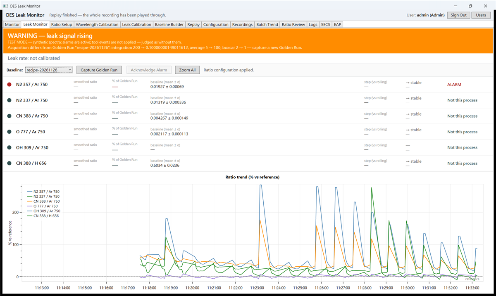

# 新生產機台測漏策略(11/26 DV 測試之後)與 Replay 驗證

這份是根據 11/26 洩漏閥加量測試(`production-20261126-dv-test-zh-TW.md`)修訂的測漏策略,
取代 11/25 文件(`production-20261125-precoat-recipe-leak-strategy-zh-TW.md`)§5.3 的比值組。
分類器、取樣與 batch 設定沿用 11/25 §5.1–§5.2、§5.5。
策略已經在開發機用 App(master `0232ba7`)Replay 11/26 與 11/25 的錄檔驗證過(§4)。

設定片段:`tools/analysis/20261126/strategy-settings-fragment.json`(只替換裡面列的鍵,其他保留)。
Replay 用的工具:`make_replay_seq.py`(把多筆錄檔串成一個 Replay 檔)、`replay_summary.py`(逐 step 摘要)。
頭尾 N₂ 突波的分析:`head_tail_n2.py`(§6)。

> **結論**
>
> 1. **主判改成 N₂ 357 / Ar(Integral),第二判是 N₂ 337 / Ar(RawMean,σ 判定)**,`RequireTwoForAlarm`。
>    CN、O 777、OH 全部退為 TrendOnly。
> 2. **11/26 的錄檔 Replay:DV 0–400 沒有 Alarm,DV 500 第一個 step 開段後 25 s 進入 Alarm**,之後一直鎖存。
>    precoat 後位置 1–2 只有 Warning。
> 3. **Golden Run 必須當天、在 recipe 平台(precoat 後第 7 步以後)用 Baseline Builder 重建。**
>    用 11/26 的 GR 判 11/25(沒漏氣)的錄檔,precoat 後位置 1–2 兩個指標的中位數都超過 Alarm 門檻,
>    只是 step 短、確認時間沒走完才停在 Warning。跨日的 GR 不能用。
> 4. 偵測能力不變:**只有 DV 500 級(約 0.1–0.3 Torr/min 以上)抓得到**。這套策略能做到的是「大漏會報、無漏不誤報」,
>    不是 mTorr/min 級的規格。
> 5. **每個 step 頭尾各約 2 s 有 N₂ 突波**(×40–90 與 ×3–29,是 DV 500 訊號的幾十倍),是機台送氣順序、不是漏氣(§6)。
>    頭段在分類器判定之前,不判;**尾段會被判定**,目前靠 15 s 確認時間擋住,16 步沒有一步因此改變判定。
>    所以 `confirmSeconds` 不能縮短;要真正排除尾段需要 App 改(issue #146)。

---

## 1. 為什麼這樣選

11/26 DV 文件 §3 的離線抽法說 N₂ 337 peak-height 最乾淨,但上了引擎之後兩個限制改變了選擇:

1. **Golden Run 要求 mean/σ ≥ 10**(`MinBaselineMeanToSigma`,逐幀算)。
   N₂ 337 的 PeakHeight 在沒漏氣時只有約 80 counts、一個像素的雜訊就占 20 %,mean/σ 只有 4.6,
   Baseline Builder 直接拒絕(`not clear of zero`),也就沒有 GR 可判。
2. **SNR 門檻 5**:CN 388 用現場的取線(±1.5 nm)SNR 中位數只有 2.9,每一幀都是 `LowSignal`,一樣沒有基準。

所以用離線模擬引擎的取線(Ar 用 Integral、線性背景)比較了七種取線,選 mean/σ 夠、DV 500 反應大的:

| 取線 | GR mean/σ | SNR 中位數 | precoat 後位置 1 / 2 / 3 | DV 0–400(位置 4–12) | DV 500 |
|---|---:|---:|---:|---:|---:|
| **N₂ 357 Integral**(356.4 ±1.4) | 27 | 29 | +21 / +16 / +11 % | −4 … +4 % | **+78–84 %** |
| N₂ 357 PeakHeight | 41 | 15 | +26 / +17 / +11 % | −4 … +4 % | +62–67 % |
| N₂ 337 PeakHeight(寬背景) | 4.6 | 3.1 | — | — | — |
| N₂ 337 Integral | 3.2–3.4 | 5–6 | — | — | — |
| CN 388 PeakHeight(現場 ±1.5) | 22 | **2.9** | — | — | +6 % |
| CN 388 PeakHeight(11/25 ±0.6) | 28 | 8 | +28 / +17 / +13 % | −2 … +6 % | +4 % |
| CN 帶積分(384.5–389.5) | 6.5 | 5 | — | — | — |

N₂ 337 RawMean(現場原本那條)不在表裡,因為它是 pedestal 值、只能用 σ 判:
GR 0.01319 ± 0.000336(mean/σ 39),DV 500 是 +14 到 +19 σ,位置 1–3 是 +7、+7、+5 σ。

兩條都是 N₂,不是兩種物種 —— 這台 recipe 看不到 O(11/26 DV 文件 §2.1),CN 對 DV 500 只有 +4–6 %,
沒有第二種物種可用。`RequireTwoForAlarm` 在這裡擋的是**取線與雜訊**造成的單邊誤報,
以及 precoat 後前幾步兩條各自不同的上升(N₂ 357 是 +21 %、N₂ 337 是 +7 σ,同時都過門檻的機會很小)。

## 2. 設定

### 2.1 比值組(全部 `ProcessClass = Recipe`)

| # | key | 名稱 | 分子 | 分母 | Role | 門檻 |
|---|---|---|---|---|---|---|
| 1 | `R_N2357_Ar` | N2 357 / Ar 750 | N₂ 356.4 `Integral` ±1.4,背景左 gap 2.0 寬 1.5、右 gap 1.5 寬 1.5,不搜峰 | Ar 750.4 `Integral` ±1(波長修正 +0.4) | **Alarm** | ×1.3 / ×1.4、3 σ / 6 σ |
| 2 | `R_82ecc466` | N2 337 / Ar 750 | N₂ 337.1 `RawMean` ±1.5 | 同上 | **Alarm** | 5 σ / **10 σ**(pedestal,只用 σ) |
| 3 | `R_d1cfada5` | CN 388 / Ar 750 | CN 388.3 `PeakHeight` ±0.6,搜峰 ±1 | 同上 | TrendOnly | — |
| 4 | `R_58006cc7` | O 777 / Ar 750 | O 777.2 `RawMean` ±0.5 | 同上 | TrendOnly | — |
| 5 | `R_0c991e70` | OH 309 / Ar 750 | OH 308.9 `PeakHeight` ±1.5 | 同上 | TrendOnly | (SNR 不足,沒有基準) |
| 6 | `R_5e6412df` | CN 388 / H 656 | CN 388.3 `PeakHeight` ±0.6 | H 656.5 `PeakHeight` | TrendOnly | — |

其他:`emaTauSeconds` 5、`confirmSeconds` 15、`minSnr` 5;`requireTwoForAlarm = true`。
N₂ 337 的 10 σ 是刻意放寬的:位置 1–2 是 +7 σ,DV 500 最小 +14 σ,10 σ 剛好在中間。

### 2.2 分類器、觸發與 batch(同 11/25 §5.2,幀數依 1.1 s/幀)

- 規則:`N2 336.7 / Ar 750.8`(兩邊 RawMean ±0.5)`> 5` → Precoat、`< 0.5` → Recipe,fallback 空白(Unknown 不判)。
- `decideAfterFrames` **10**(約 11 s,跳過頭兩幀 N₂ / Ar 是平台 500 倍的轉換段)。
  **下限是 3**:頭兩幀的分類比值 0.7–1.4 落在兩條規則之間,判成 Unknown 後類別鎖住,整個 step 都不判定,畫面也不會提示(§6.2)。
- 類別門檻:Precoat 0、Recipe 3000;觸發 `SpectrumPercentile` p99 > 1000。
- batch:`batchStartClass = Precoat`、視窗 10–24 s、`minWindowFrames` 5。

### 2.3 Golden Run:每天重建

1. 當天 precoat 之後跑到**第 7 步以後**(CN、N₂ 357 的 precoat 記憶效應在第 6 步左右退完)。
2. Baseline Builder → 日期選當天 → 勾連續 **6 個** recipe step → **Scan ticked**,State 都要是 `Recipe`。
3. 每筆 **Baseline window** 設 `15`–`40` s(15 s 之前 N₂ 的頭幀尾巴還沒退完)。
   視窗是**錄檔的檔案時間**:11/26 電漿在檔案 2.2 s 亮、尾幀在 43–44 s。**終點要比尾幀早 3 s 以上**,
   step 長度不同(11/25 是 32–36 s)就照圖上的尾幀改終點;包到尾幀 mean/σ 會掉到 0.5,Build 會拒絕。
   起點不要改晚:15 s 與 N₂ 337 的 10 σ 是一起定的(§6.4)。
4. **Build**,確認 N₂ 357 與 N₂ 337 都有基準、mean/σ 分別在 25 與 35 以上,然後 **Save as active baseline**。

11/26 用位置 7–12(17:13:53–17:20:16)建的 `recipe-20261126`:

| 比值 | 基準 |
|---|---|
| N2 357 / Ar 750 | 0.01927 ± 0.00069(mean/σ 27.9,138 幀) |
| N2 337 / Ar 750 | 0.01319 ± 0.000336(mean/σ 39.2) |
| CN 388 / Ar 750 | 0.00427 ± 0.000149(mean/σ 28.7) |
| O 777 / Ar 750 | 0.00212 ± 0.000113(mean/σ 18.7) |
| CN 388 / H 656 | 0.603 ± 0.0236(mean/σ 25.6) |
| OH 309 / Ar 750 | 沒有基準(SNR 不足) |

> 這 6 步其實開著 DV 300 / 400(12 sccm、約 42 sccm)。11/26 DV 文件已經證明它們跟 DV 0–200 分不出來,
> 那天又沒有其他平台區的無漏 step,所以拿來當基準。上機時要用**真的沒漏**的 step。

## 3. 開發機的本機設定(2026-11-27)

`%AppData%\OES_Leak_Monitor\settings.json` 已經照 §2 改好,GR `recipe-20261126` 是作用中的基準。
改之前的檔:`settings.json.bak-before-20261126-strategy-20261127093857`(SECS 驗收用的比值組在裡面)。
取樣(`devices[0]`)沒有改 —— 開發機沒有光譜儀,Replay 時會出現 `Acquisition differs from Golden Run` 的提示,
那只是說測試模式的取樣參數跟錄檔不同,比值的判定不受影響。

## 4. Replay 驗證

做法:Replay 一次只播一個檔,開始時會重設引擎,所以用 `make_replay_seq.py` 把 precoat 與連續的 recipe step 串成一個檔,
step 之間的空檔縮成 12 s,用 20× 播一次。`settings.json` 的 `simulationCsvPath` 指到那個檔,
Connect → Start(測試模式)→ Replay → Play。結果用 `replay_summary.py` 讀 `SIMP_Ratio_*.csv`。

### 4.1 11/26:precoat + DV 0 → 500 共 16 步(同日 GR)

```
python3 -I tools/analysis/20261126/make_replay_seq.py <Temp>\P_OES1_1126162108_seq.csv \
    P_OES1_1126162108.csv P_OES1_1126170057.csv … P_OES1_1126173137.csv
```

| 位置 | DV | 類別 | N₂ 357 vs GR | N₂ 337 vs GR | 判定 |
|---:|---|---|---:|---:|---|
| — | precoat | Precoat | — | — | Idle(不判定) |
| 1 | 0 | Recipe | +21 % | +7 σ | Normal → **Warning** |
| 2 | 0 | Recipe | +17 % | +7 σ | Normal → **Warning** |
| 3 | 0 | Recipe | +11 % | +5 σ | Normal |
| 4–6 | 200 | Recipe | +5 … −5 % | +3 … 0 σ | Normal |
| 7–12 | 300 / 400 | Recipe | −4 … +2 % | −1 … 0 σ | Normal |
| **13** | **500** | Recipe | **+82 %** | **+18.5 σ** | Normal → **ALARM**(開段後 25 s) |
| 14–16 | 500 | Recipe | +77 … +81 % | +14 … +16 σ | ALARM(鎖存) |

每個 step 前 14 幀是 `Idle`:分類器在第 10 幀才判定類別,之前不判。


### 4.2 11/25:precoat + 弱 step + 19 步(沒漏氣、別天)判 11/26 的 GR

11/25 是 `averageCount` 20(4 s/幀),這一輪暫時把 `decideAfterFrames` 改成 3、`minWindowFrames` 改成 3(11/25 Replay SOP §0),
做完已改回 10 / 5。

| 位置 | N₂ 357 vs GR | N₂ 337 vs GR | 判定 |
|---:|---:|---:|---|
| 弱 step | — | — | Idle(低於 Recipe 門檻 3000) |
| 1 | +57 % | +11 σ | Normal → Warning |
| 2 | +55 % | +11 σ | Warning |
| 3 | +51 % | +9 σ | Warning |
| 4–6 | +42 … +33 % | +7 … +4 σ | Warning |
| 7–19 | +30 … +20 % | +3 … −2 σ | Warning(N₂ 357 單獨鎖在 ALARM) |

**沒有 composite Alarm,但這是運氣**:位置 1–2 兩條的中位數都超過 Alarm 門檻(×1.4、10 σ),
只是 4 s 一幀、step 36 s,判定開始(第 3 幀,12 s)後到結束只剩約 24 s,EMA 加上 15 s 確認沒來得及同時成立。
平台區 N₂ 357 還高 20–30 %,N₂ 357 自己一整天鎖在 ALARM。



結論:**N₂ 357 跨日漂移 +20–30 %**(視窗沉積、腔體狀態),跟 DV 500 的 +80 % 只差三倍。GR 一定要當天重建(§2.3);
換腔體零件、清腔、或停機超過一天之後也要重建。

### 4.3 Replay 時看到的 App 問題

第二輪 Replay 的比值 CSV 寫成 `P_Ratio_1127111221.csv`,不是 `SIMP_Ratio_*`:
日誌裡 `RatioCsvOpened`(11:12:21.603)比 `ReplayStarted`(.604)早 1 ms,
應該是合成光譜的一幀在「關閉錄檔 → 換成 SIM 前綴」之間重新開了比值 CSV。
**重播資料被寫成正式量測的檔名**,這正是 `docs/dev/replay.md` 說要避免的情況。第一輪沒有發生。原因是 `BeginReplayOutput` 先關錄檔、後換前綴,追蹤在 issue #142。

## 5. 上機步驟

1. 先備份現場 `settings.json`。用記事本把 `strategy-settings-fragment.json` 的 `logger` 四個鍵與 `leakMonitor` 的五個鍵替換進去。
   分類器在畫面上沒有設定欄位,只能改檔。
2. 確認 `devices[0]` 是積分 200 ms、`averageCount` 5。
3. 開 App → Ratio Setup 確認 6 條比值、Process class 都是 Recipe。
4. 生產跑過 precoat 與至少 12 個 recipe step 之後,照 §2.3 用當天第 7–12 步建 GR,Save as active baseline。
5. 之後每天(或每次清腔後)照 §2.3 重建一次。
6. **不要**在沒有電漿或只有 precoat 時按 Capture Golden Run(11/26 的 16 次擷取都是這樣丟掉的)。

## 6. 每個 step 頭尾的 N₂ 突波

11/26 的 16 個 recipe step 每一個都是:電漿一亮先有一團 N₂,很快退掉;結束前最後兩幀又有一團。
用 `head_tail_n2.py` 逐幀量(取線照 §2.1,GR 照 §2.3 用位置 7–12、檔案時間 15–40 s;
離線 N₂ 357 mean/σ 27.4,引擎是 27.9,所以下面的 σ 可以直接對照引擎)。

### 6.1 現象

| | 時間(電漿亮起後) | N₂ 357 / Ar 對平台 | N₂ 337 / Ar 對 GR | 其他 |
|---|---|---:|---:|---|
| **頭** | 0、1.1 s(2 幀) | ×40–92 | +860 … +2 240 σ | 分類比值 0.7–1.4;當天第一步(位置 1)只有 ×2–10 |
| 頭段退場 | 11–15 s | 仍 ×1.06–1.10 | ×1.04–1.07 | 13–18 s 才回到平台 ±5 %;DV 500 時 9 s 就回到(漏進來的 N₂ 蓋過去) |
| **尾** | 最後 2 幀(40.8、41.9 s) | ×0.9–29 | +4 … +680 σ | Ar 掉到平台 56–77 %、p99 還有 4 000–9 500 |

- 大小跟 DV 無關:頭幀 DV 0–400 是 ×68–92(位置 1 除外)、DV 500 是 ×66–71;尾幀第二幀 DV 0–400 ×15–20、DV 500 ×25–29
  (多出來的是漏氣本身)。DV 500 在平台只有 ×1.8 / +15 σ,突波是它的幾十倍。
- 尾幀 Ar 掉、N₂ 升:看起來是電漿還沒關、機台已經在換含 N₂ 的氣體(purge 或下一步)。頭幀則是電漿亮時腔體還有 N₂。
  兩者都是**送氣順序**,不是漏氣。哪一個步驟要問客戶(11/25 文件 §8 第 1 題)。
- 位置 1(前一筆錄檔在 19 分鐘前)頭幀小、尾幀也沒有 N₂ —— 序列中的位置會改變突波大小,不能拿突波大小當指標。

### 6.2 頭段:不判,但有兩個要注意的地方

分類器在第 10 幀(約 11 s)才判定類別;在那之前比值是 `NotApplicable`,`MarkNotApplicable` 會清掉 EMA,
所以頭幀不判定、也不會被平滑帶進後面。

1. **`decideAfterFrames` 不能 ≤ 2。** 頭兩幀分類比值 0.7–1.4,既不 > 5(Precoat)也不 < 0.5(Recipe),判成 Unknown,
   類別鎖住,整個 step 不判定。第 3 幀起是 0.05–0.36,已經會判成 Recipe;第 10 幀是 0.025–0.039,離 0.5 很遠。
2. **判定一開始讀值還偏高。** 11–15 s 比自己的平台高 5–10 %(N₂ 357)/ 4–7 %(N₂ 337),
   位置 1–2 的 Warning 有一部分是這個、一部分是位置衰減(11/24 文件),分不開。

### 6.3 尾段:會判定,靠 15 s 確認擋住

類別在第 10 幀就鎖住,尾幀 p99 4 000–9 500 又高過 Recipe 門檻 3 000,所以**尾幀照樣判定**。
穩態的 p99 是 6 300–7 000,跟尾幀重疊,改電漿門檻擋不掉。

尾幀讓 EMA 在最後兩幀衝到 ×4.3–8.6 / +77 … +180 σ(DV 0–400 約 ×4.3–5.4)。
但尾段只有約 2.2 s,加上電漿熄滅的 grace 1.5 s,也遠不到 `confirmSeconds` 15 s。
照引擎的 EMA、門檻與確認規則模擬 16 步,**含尾幀與去掉最後兩幀的判定完全一樣**:

| 位置 | N₂ 357 連續超 Alarm | N₂ 337 連續超 Warn / Alarm | 判定 |
|---|---|---|---|
| 1–2(DV 0) | 0–1.1 s | 32 s / 3–6 s(去尾 30 s / 3–6 s) | Warning(同 §4.1) |
| 3–12 | 0–1.1 s(都是尾幀) | ≤ 19 s / ≤ 1.1 s | Normal 或 Warning |
| 13–16(DV 500) | 32 s(去尾 30 s) | 32 s / 32 s(去尾 30 s) | Alarm |

**風險在臨界的情況**:尾段會把任何已經在門檻上的連續時間再加約 2 s,原本 13–14 s 就會變成 15 s 被確認。
而且 `RequireTwoForAlarm` 擋不了 —— 這台的兩條 Alarm 比值都是 N₂,尾幀讓它們同時衝高。
所以:

- **`confirmSeconds` 不能縮短**;step 變短時尾段占的比例變大,也要重新看。
- 趨勢圖、比值 CSV 每個 step 結束都會有尖峰(圖 1);FDC 若收 step 內的比值最大值,看到的會是尾幀。
- `EffectiveSigma` 取 `max(基準 σ, 即時 σ)`,尾幀把即時 σ 撐大、門檻放寬 —— 這只會讓尾幀更難越線,上面的模擬沒算這一項。

真正排除尾幀要 App 在已分類的 step 裡逐幀加一道「這一幀不判」的閘(參考線比本步平台掉超過 20 %,
或分類比值超過 recipe 上限約 0.05),追蹤在 **issue #146**。

### 6.4 Golden Run 視窗

Baseline Builder 的視窗是檔案時間。11/26 的錄檔電漿從 2.2 s 亮、最後一幀在 44 s,15–40 s 離尾幀還有 3 s:

| 視窗(檔案時間) | N₂ 357 mean/σ | N₂ 337 mean/σ | DV 500 的 N₂ 337 |
|---|---:|---:|---:|
| **15–40 s**(§2.3) | 27.4 | 40.3 | +15 σ |
| 20–40 s | 34.0 | 52.5 | +20 σ |
| 20–38 s | 34.8 | 55.2 | +21 σ |
| 15–45 s(包到尾幀) | 0.5 | 0.7 | 0 σ |

- **包到尾幀,基準就毀了**(Build 會因 mean/σ < 10 拒絕)。直接按 Capture Golden Run、擷取期間跨過 step 結束,也會這樣。
- **起點改晚看起來比較好,其實不要改。** σ 小 25 %,N₂ 337 的 10 σ 線跟著往下;模擬下位置 1–2 的 N₂ 337
  連續超 Alarm 18.7–27.5 s,**單獨鎖在 ALARM**(整體因 `RequireTwoForAlarm` 仍是 Warning)。
  N₂ 357 的門檻是 ×1.3 / ×1.4 決定的(6 σ 只有 ×1.22),σ 變小也不會更靈敏。
  所以起點 15 s 與 N₂ 337 的 10 σ 是一組;要改起點就要把 σ 門檻按比例調高(約 13–14 σ),等於沒改。
- 視窗終點則一定要跟著 step 長度:比尾幀早 3 s 以上(§2.3)。

## 7. 還沒解決的事

- **step 結束的尾幀會被判定**(§6.3),要 App 加逐幀閘,issue #146。

- **偵測下限**:只到 DV 500 級。要更好要靠製程端(在 recipe 以外找一個沒有 C₂H₂ 的含 Ar 步驟),不是調門檻。
- **precoat 後位置 1–3** 兩個指標都偏高;同日 GR 是 Warning,跨日 GR 接近 Alarm。依位置建 GR 的需求是 issue #135。
- **DV 500 的 ROR**、DV 450 的補測(11/26 DV 文件 §7)。
