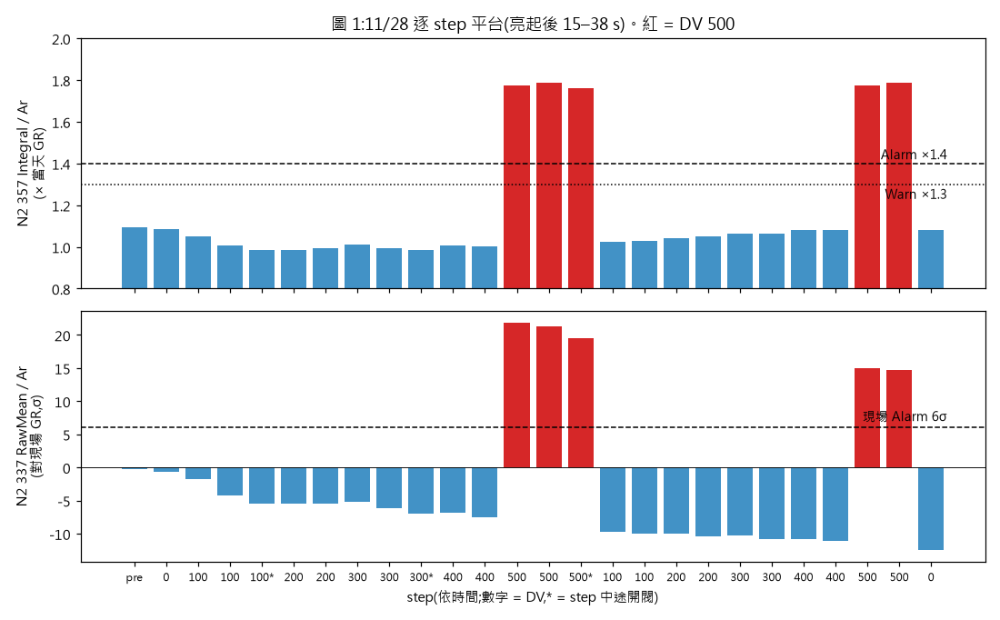
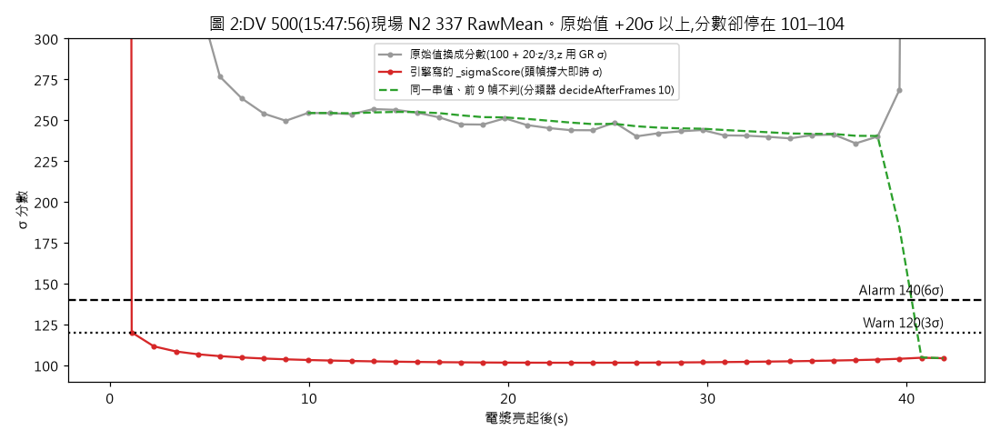

# 新生產機台 11/28 第二次洩漏閥(DV)測試:DV 500 看得到,現場 App 卻全程 Normal

2026-11-28 15:10–16:24,在 11/25、11/26 那台新生產機台(precoat SiH₄/N₂/N₂O + recipe C₂H₂/He/Ar)的 recipe 上,
第二次用洩漏閥加空氣:DV 0 → 100 → 200 → 300 → 400 → 500 → 100 → … → 500 → 0,共 25 個 recipe step。
這是 11/26 策略(`production-20261126-leak-strategy-zh-TW.md`,PR #143)之後第一次在機台上試,
目的是看工具會不會報。

資料:

| 來源 | 涵蓋 | 用途 |
|---|---|---|
| `C:\DualOES\202611\28` 全譜錄檔 + 每筆的 `P_<時間>.notes.txt`(現場標的 DV) | 14:26–16:24 | 離線抽線(§2)、判定模擬(§4) |
| 同資料夾 `P_Ratio_*.csv` | 13:57–16:24 | 引擎自己的比值與 σ 分數(§3) |
| `diag_DESKTOP-4JD00UD_cc03_20261128_162443.zip` | 13:56–16:24 | 系統日誌、`settings.json`、GR「Recipe 3」 |

分析程式:`tools/analysis/20261128/dv_sim.py`(`python3 -I`),取線與判定模擬照 `20261126/head_tail_n2.py`;
圖 1–2 由 `plot_dv28.py` 產生(要 numpy / matplotlib,用 Windows 的 `py -3.13` 跑)。

> **結論**
>
> 1. **又只有 DV 500 看得到。**N₂ 357 Integral / Ar 在 DV 500 是當天平台的 ×1.75–1.80,五步都一樣(兩輪、含一步中途開閥);
>    DV 100–400 跟 DV 0 分不出來(×0.98–1.08,就是漂移)。跟 11/26 的結果一致:下限在 DV 400 與 500 之間。
> 2. **現場 App 從頭到尾 `Normal`,DV 500 也沒有 Warning。**原因不在訊號 ——
>    引擎自己算的 N₂ 337 / Ar 原始值在 DV 500 是 GR 的 **+15 … +22 σ**,但寫出來的 σ 分數只有 101–104(Warn 是 120)。
> 3. **主因是分類器沒開。**每步頭兩幀的 N₂ 突波(平台的 50–60 倍)直接進了 EMA,把即時 σ 撐大,
>    整個 step(約 40 s)都退不回來;三條有基準的 Alarm 比值全是 RawMean(只能用 σ 判定),全部被拖住。
>    11/26 策略要用的 N₂ 357 Integral 用的是 line picker 的窄窗,GR 時 SNR 不到 5、沒有基準。
>    **現場設定跟 11/26 策略不一樣**(§3.2)。
> 4. **照 11/26 策略、當天建 GR,模擬的結果是 DV 500 五步全部 ALARM**(亮起後 25 s;中途開閥的那步 34 s),
>    DV 0–400 沒有 Alarm。
> 5. **用 11/26 的 GR 跨日判,第二輪 DV 500 只到 Warning,第一步還會誤報 Warning。**
>    N₂ 357 跨日高了 17 %,N₂ 337 RawMean 在當天又往下漂了 25 %(§4.2)。GR 每天重建是必要的;
>    N₂ 337 RawMean 當第二判也偏脆弱(§5)。

---

## 1. 時間線與測試方式

- 14:26 precoat(分類比值 RawMean 336.7 / 750.8 中位數 52)、14:33 一個 recipe step,之後停了 36 分鐘。
- 15:10:43 recipe step(沒有 notes,下表位置 0),15:13:34 那步標「DV=0 Golden Run」——
  15:13:49 在這步按了 **Capture Golden Run**(20 s),存成「Recipe 3」。
- 15:17 起每步都是 **Stop → Reset → Start** 手動開一個新的比值 CSV,所以每步一個 `P_Ratio`。
- 現場標記:
  - 「DV open 1min / pump down 1 min」—— 閥先開著再進 recipe,整步都有漏。
  - 「DV open to pressice」(位置 4、9、14)—— step 中途開閥:DV 500 那步(15:50:49)N₂ 在亮起後 14–17 s 才升,約 4 s 到平台,
    之後跟其他 DV 500 步同一個值。
- 取樣:積分 200 ms、`averageCount` 5,每幀 1.1 s,每步電漿約 39 幀、42 s。
- 這次沒有 ROR 紀錄;流量換算沿用 11/26 文件 §4(DV 400 ≈ 42 sccm、DV 500 ≈ 590 sccm,後者只有閥表)。

## 2. 逐 step 的平台

`dv_sim.py` §1–2:電漿亮起後 15–38 s 的平均。N₂ 357 = 356.4 ±1.4 `Integral`(11/26 策略 §2.1 的取線);
N₂ 337 RawMean 是現場的 `R_41779f99`(±0.89 nm),對現場 GR「Recipe 3」(0.013764 ± 0.000267)。

| 位置 | 時間 | DV | N₂ 357 / Ar ×10⁻³ | × 當天 GR | 現場 N₂ 337 RawMean 對 GR | CN 388 / Ar ×10⁻³ |
|---:|---|---|---:|---:|---:|---:|
| 0 | 15:10 | (GR 之前) | 20.42 | 1.09 | −0.3 σ | 4.08 |
| 1 | 15:13 | 0(GR) | 20.31 | 1.09 | −0.7 σ | 3.99 |
| 2–4 | 15:17–15:22 | 100 | 18.4–19.7 | 0.99–1.05 | −1.8 … −5.4 σ | 3.67–3.91 |
| 5–6 | 15:25–15:28 | 200 | 18.4–18.6 | 0.98–0.99 | −5.5 σ | 3.62–3.68 |
| 7–9 | 15:31–15:36 | 300 | 18.4–18.9 | 0.98–1.01 | −5.2 … −7.0 σ | 3.64–3.73 |
| 10–11 | 15:39–15:42 | 400 | 18.8 | 1.00 | −6.9 … −7.5 σ | 3.63–3.66 |
| **12–14** | 15:45–15:50 | **500** | **32.9–33.4** | **1.76–1.79** | **+19.6 … +21.9 σ** | 4.18–4.24 |
| 15–16 | 15:55–15:58 | 100 | 19.2 | 1.02–1.03 | −9.7 … −10.0 σ | 3.79–3.80 |
| 17–20 | 16:01–16:09 | 200 / 300 | 19.5–19.9 | 1.04–1.06 | −10.0 … −10.9 σ | 3.84–3.96 |
| 21–22 | 16:12–16:14 | 400 | 20.2 | 1.08 | −10.9 … −11.2 σ | 3.93–3.95 |
| **23–24** | 16:16–16:19 | **500** | **33.2–33.5** | **1.77–1.79** | **+14.7 … +14.9 σ** | 4.47 |
| 25 | 16:23 | 0 | 20.22 | 1.08 | −12.5 σ | 4.06 |

讀法:

- **N₂ 357 Integral 很穩。**DV 0–400 整段在 ×0.98–1.09 之間;位置 0–1 的 ×1.09 是 precoat 之後的位置效應(11/24、11/26 都看過)。
  DV 500 是 ×1.76–1.79,兩輪一樣,跟 11/26 的 +80 % 相同。
- **DV 400 看不到。**第一輪 DV 400 對 DV 300 是 +0.8 %、第二輪 +1.6 %,都在相鄰 step 的差距內。
  若訊號與流量成正比,42 sccm 對 590 sccm 應該是 +5–6 %;實測比這小,DV 400 的實際流量或線性度仍未定。
- **DV 500 關掉之後下一步就回到基準**(位置 15、25),沒有殘留。
- **N₂ 337 RawMean 一路往下漂**:從位置 1 到 25 少了 25 %(對 GR −12.5 σ),跟 11/26 看到的 UV 連續光衰減同一件事 ——
  RawMean 不扣背景,連續光掉多少它就掉多少。第二輪 DV 500 因此只剩 +15 σ。
- CN 388 / Ar 在 DV 500 +13–15 %,但第二輪無漏的 step 也爬到 3.9–4.0,分不開。

## 3. 現場 App 為什麼沒報

### 3.1 引擎自己的紀錄

整天的 `P_Ratio` 一共 5 428 幀,`OverallState` 只有 `Idle`(4 435)和 `Normal`(993)。
`dv_sim.py` §4 把每步的引擎值抽出來(亮起後 15–38 s,對 GR「Recipe 3」):

| DV | `R_41779f99` N₂ 337 RawMean | `R_40cb92c0` N₂ 357 RawMean | `R_58006cc7` O 777 RawMean | 第 3 幀以後 σ 分數最大 | 狀態 |
|---|---:|---:|---:|---:|---|
| 0–400 | −1 … −11 σ | −1 … −8 σ | −0.4 … +1.0 σ | 110–117 | Normal |
| **500** | **+15 … +22 σ** | **+15 … +19 σ** | +4 … +5 σ | **111–117** | **Normal** |

σ 分數 = 100 + 20 · z / `SigmaWarn`(`ratio-csv-sigma-score-zh-TW.md`),Warn 是 120、Alarm(6 σ)是 140。
**DV 500 跟 DV 0–400 的分數最大值一樣**,都是頭幀退場時的那一段,不是漏氣。

機制(圖 2):

1. 電漿亮起的第一幀 N₂ 337 / Ar 是 0.58(平台的 30 倍),引擎在這幀起 EMA,分數 14 286。
2. 第二幀起 EMA 往下追,EWMA 的即時 σ 被這一跳撐到 GR σ 的幾十倍。
   `EffectiveSigma = max(基準 σ, 即時 σ)`,所以分數 = 偏移 ÷ 一個很大的 σ,掉到 101–104。
3. 即時 σ 要 `2τ · ln(即時 σ / 基準 σ)` 才退得回來,τ = 5 s 時大約一分鐘;step 只有 42 s,**整步都退不回來**。
4. 同一串原始值,只要前 9 幀不判(分類器 `decideAfterFrames` 10 的效果),分數從第 10 幀起就是 250、整步在 Alarm 之上(綠線)。
   最後的下降是尾幀(11/26 策略 §6.3)。

三條有基準的 Alarm 比值都是 RawMean,`ValueHasPedestal` 讓它們只能用 σ 判定,三條都一樣被拖住。
**沒有一條用倍數判定的比值有基準**,所以沒有別的路能報。

### 3.2 現場設定與 11/26 策略的差別

`settings.json`(diag 包,15:14 起作用中)對照 `tools/analysis/20261126/strategy-settings-fragment.json`:

| 項目 | 11/26 策略 | 11/28 現場 | 結果 |
|---|---|---|---|
| 分類器 | 開;N₂ / Ar > 5 Precoat、< 0.5 Recipe;`decideAfterFrames` 10 | **`enabled: false`** | 頭幀進 EMA,σ 判定全部失效(§3.1) |
| N₂ 357 主判 | 356.4 ±1.4 `Integral`,背景左 gap 2.0 寬 1.5、右 gap 1.5 寬 1.5 | 357.5 ±0.89 `Integral`,背景 gap 0.71 寬 1.07(line picker 預設) | GR 時 20 幀都在 SNR 5 以下,**沒有基準** |
| N₂ 337 第二判 | `R_82ecc466` 337.1 ±1.5 RawMean,5 σ / 10 σ | `R_82ecc466` 是 TrendOnly;另加 `R_41779f99` ±0.89 RawMean,3 σ / 6 σ | 有基準,但被 §3.1 拖住 |
| 其他 Alarm 比值 | CN、O 777、OH 都是 TrendOnly | CN 388 / Ar、O 777 / Ar 是 Alarm;另有 N₂ 337 Integral、N₂ 357 RawMean | CN、N₂ 337 Integral 沒有基準(SNR);O 777 只能用 σ |
| `ProcessClass` | Recipe | 空白(全部判) | — |
| GR | Baseline Builder,當天平台區 6 步、檔案時間 15–40 s | 現場按 Capture,位置 1 的 20 s | 時間點本身沒問題(亮起後 13–33 s),但只有一步 |

GR「Recipe 3」的擷取紀錄(15:14:11):CN 388 / Ar、CN 388 / H 656、N₂ 357.5 Integral **沒有基準**;
N₂ 337.1 Integral **只有 1 / 20 幀過 SNR**,被拒;留下 5 條(O 777、兩條 N₂ 337 RawMean、OH 309、N₂ 357 RawMean)。

App 版本仍是 **7f37878**(11/25),還沒有 PR #144 的 Replay 修正;這對現場判定沒有影響。

## 4. 照 11/26 策略會怎樣(模擬)

`dv_sim.py` §2 照 `RatioMonitor` 模擬:前 9 幀不判(分類器),第 10 幀起 EMA τ 5 s;
N₂ 357 門檻 max(×1.3 / ×1.4, 3 σ / 6 σ)、N₂ 337 RawMean 5 σ / 10 σ;`confirmSeconds` 15;即時 σ 放寬門檻的效果沒有模擬。
同一套模擬在 11/26 算出 DV 500 第一步亮起後 25 s Alarm,跟那天的 App Replay(策略文件 §4.1)一樣。

### 4.1 當天 GR

GR 用位置 5–10(DV 200–400 共 6 步,檔案時間 15–40 s):N₂ 357 0.01871 ± 0.000463(mean/σ 40.4)、
N₂ 337 0.00999 ± 0.000238(mean/σ 41.9)。用 DV 200–400 當基準的理由同 11/26:§2 已經看到它們跟 DV 0 分不出來。

| 位置 | DV | N₂ 357 EMA 峰值 | N₂ 337 EMA 峰值 | 判定 |
|---:|---|---:|---:|---|
| 0–1 | pre / 0 | ×1.17–1.20 | +9 σ(超 Warn 19–26 s) | N₂ 337 單條 **Warning** |
| 2–11 | 100–400 | ×1.05–1.17(尾幀 ×1.46) | +3 … +11 σ(DV 400 尾幀 +21 σ) | Normal |
| **12–13** | **500** | ×4.5–8.3(含尾幀) | +116 … +248 σ | **ALARM,亮起後 25.3 s** |
| **14** | **500(中途開閥)** | ×7.2 | +206 σ | **ALARM,亮起後 34–35 s**(開閥後約 20 s) |
| 15–22 | 100–400 | ×1.07–1.15(尾幀 ×1.40) | −2 … +12 σ | Normal |
| **23–24** | **500** | ×4.5–5.5 | +109 … +141 σ | **ALARM,亮起後 25.3 s** |
| 25 | 0 | ×1.13 | −3 σ | Normal |

DV 400 的 ×1.40–1.46 是尾幀,只有 1–2 幀,遠到不了 15 s 確認(11/26 策略 §6.3)。

### 4.2 用 11/26 的 GR(跨日)

11/26 的 GR 用同一套離線取線重算(`20261126/head_tail_n2.py`,位置 7–12、15–40 s):
N₂ 357 0.01603 ± 0.000585、N₂ 337 0.01119 ± 0.000277。
(引擎存的 `recipe-20261126` 是 0.01927 / 0.01319,Ar 取線不同、絕對值大約 1.2 倍,不能拿來跟離線值直接比。)

11/28 當天平台對 11/26:**N₂ 357 +17 %**(0.01871)、**N₂ 337 RawMean −11 %**(0.00999)。

| 位置 | DV | N₂ 357 | N₂ 337 RawMean | 判定 |
|---:|---|---|---|---|
| 0–1 | pre / 0 | EMA ×1.37–1.40,超 Warn 13–17 s | +3 … +4 σ | 位置 0 **Warning**(16.5 s ≥ 15 s 確認) |
| 2–11、15–22、25 | 0–400 | ×1.22–1.36,超 Warn ≤ 7 s(DV 400 尾幀 ×1.6–1.7) | −7 … +5 σ(尾幀 +14 σ) | Normal |
| 12–14 | 500(第一輪) | Alarm(確認 25 / 32 s) | Alarm(確認 25 / 41 s) | **ALARM** |
| 23–24 | 500(第二輪) | Alarm(確認 25 s) | 超 Warn 32 s、超 Alarm 只有 1 幀 | **Warning**(`RequireTwoForAlarm`) |

- **N₂ 357 Integral 跨日漂 +17 %**,已經貼著 Warn ×1.3;11/25 對 11/26 也是 +20–30 %(策略文件 §4.2)。
  這條在當天之內很穩(§2),跨日不穩。
- **N₂ 337 RawMean 跨日 −11 %、當天之內又 −25 %**,第二輪 DV 500 被漂移吃掉一截,不到 10 σ。
- 兩條一起看:**跨日的 GR 在這台會同時誤報(位置 0)又漏報(第二輪 DV 500)**。

## 5. 建議

1. **上機要整份套 `strategy-settings-fragment.json`**,不要用 line picker 重新加線。
   分類器(含 `decideAfterFrames` 10、Recipe 類別門檻 3 000)是 σ 判定能動的前提,不是可有可無的選項。
2. **GR 每天用 Baseline Builder 重建**(策略文件 §2.3),不要只用 Capture 抓一步。11/28 這種測試,當天的 DV 200–400 平台步就可以用。
3. **N₂ 337 RawMean 當第二判太容易漂**:當天之內 −25 %,N₂ 357 Integral 當天之內只有 ±5 %。
   可考慮改成扣背景的寬窗 Integral / PeakHeight(11/26 文件 §3 的「寬背景」N₂ 337 在 DV 500 是 ×5.5),
   需要先確認 GR 時過得了 SNR 5;改之前要再用 11/25、11/26、11/28 三天的錄檔 Replay 一次。
4. **偵測下限沒變**:DV 400(11/26 ROR 0.5 Torr/min)兩天都看不到。要知道 DV 400–500 之間在哪裡開始看得到,
   需要 DV 425 / 450 / 475 之類的點,並請客戶在 DV 500 也量一次 ROR。

## 6. 其他觀察

- SECS 仍然綁不到 IP(`Secs_Start_Failed`:位址無效),EAP 10.2.3.120:20347 從 13:57 起連不上,跟 11/26 一樣。
- batch 紀錄的類別都是 `?`(分類器沒開)。
- 每步手動 Stop / Reset / Start 對判定沒有影響(每步都從頭起 EMA),但會產生 27 個 `P_Ratio`;
  正式監控時應該讓它連續跑。
