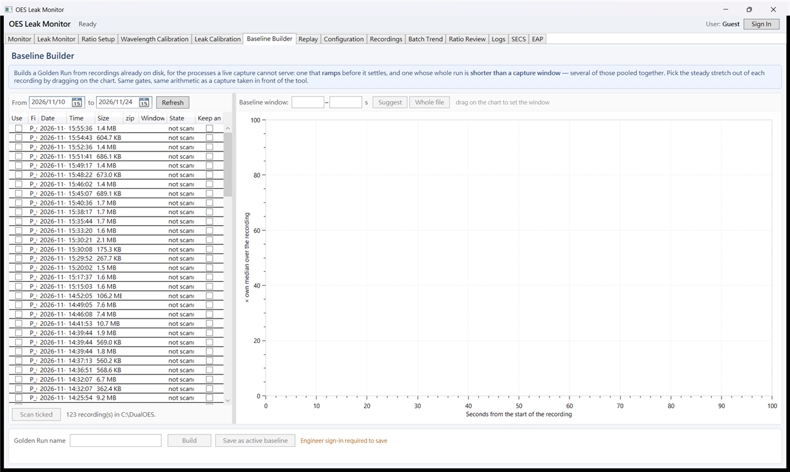
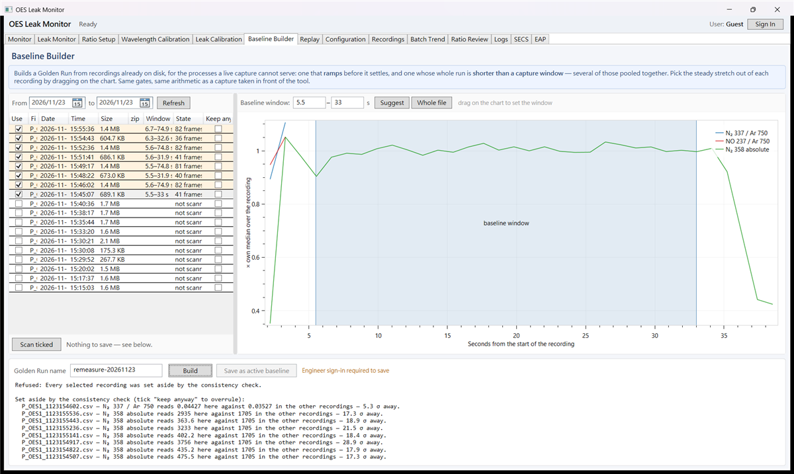
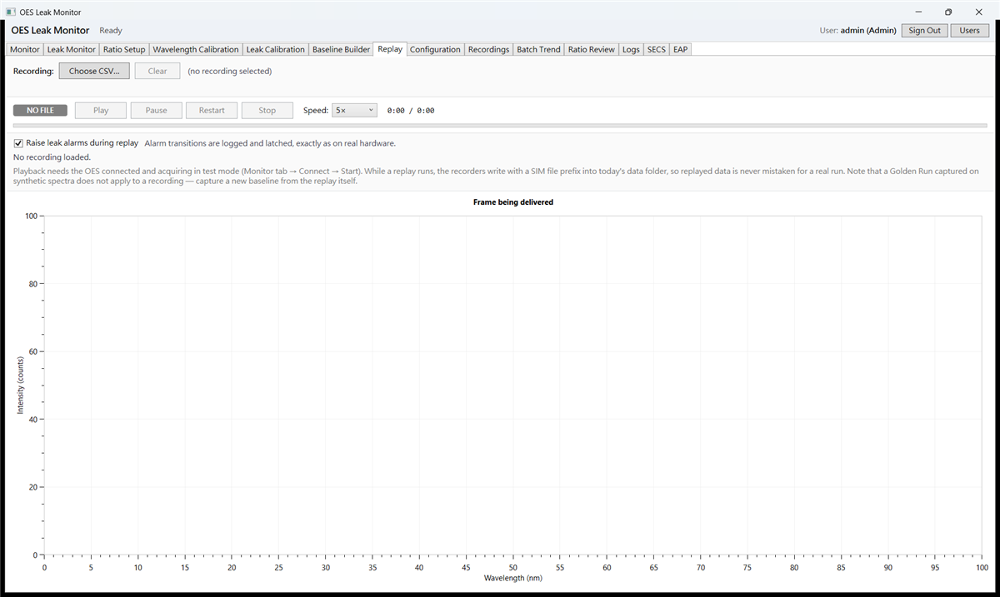

# 上機前比值重量 SOP(11/23 兩段製程)

目的:用 App 本身的譜線抽取,重量 `production-20261123-leak-strategy-zh-TW.md` 的比值組,確認結果與本文一致。

| 方法 | 誰 | 何時 |
|---|---|---|
| **A. Baseline Builder**(主要) | Operator 可做 | 隨時;不影響量測 |
| **B. Replay**(選用) | Engineer | 只在**不量測時**(要斷開光譜儀) |

> ⚠️ 全程**不按** `Save as active baseline`。

> 本文的截圖與預期值,是 2026-11-24 用 §0 的設定、對同一批錄檔在 App 上實際做出來的。
> 設定一樣,現場做出來的數字應該**完全相同**。

---

## 0. 開始前確認(Engineer 已完成)

- [ ] Ratio Setup 已有下列 9 組比值(其他比值停用)。所有譜線都是 `PeakHeight`、baseline gap 1 nm、baseline width 1 nm、peak search ±1 nm:

| # | 名稱 | 分子(中心 / 半寬 nm) | 分母(中心 / 半寬 nm) | ProcessClass | Role |
|---|---|---|---|---|---|
| 1 | N2 337 / Ar 750 | 337.1 / 0.5 | 750.4 / 0.5 | P1_Ar | Alarm |
| 2 | CN 388 / Ar 750 | 388.3 / 0.6 | 750.4 / 0.5 | P1_Ar | Alarm |
| 3 | NO 237 / Ar 750 | 237.8 / 0.6 | 750.4 / 0.5 | P1_Ar | TrendOnly |
| 4 | N2 380 / Ar 750 | 380.5 / 0.5 | 750.4 / 0.5 | P1_Ar | TrendOnly |
| 5 | O 777 / Ar 750 | 777.2 / 0.7 | 750.4 / 0.5 | P1_Ar | Guard |
| 6 | N2 337 / O 777 | 337.1 / 0.5 | 777.2 / 0.7 | P2_NoAr | TrendOnly |
| 7 | CN 388 / O 777 | 388.3 / 0.6 | 777.2 / 0.7 | P2_NoAr | TrendOnly |
| 8 | NO 237 / O 777 | 237.8 / 0.6 | 777.2 / 0.7 | P2_NoAr | TrendOnly |
| 9 | O 844 / O 777 | 844.6 / 0.6 | 777.2 / 0.7 | P2_NoAr | Guard |

- [ ] Process Classifier 已啟用:規則 `Ar 750.4 / O 777.2 > 0.5 → P1_Ar`,Fallback `P2_NoAr`
- [ ] 做完本 SOP 之前,不改 Ratio Setup、Wavelength Calibration、Logger 觸發門檻

---

## A. Baseline Builder

### A1. 列出錄檔

1. 進 **Baseline Builder** 分頁。
2. **From** 設成 `2026-11-23`,**to** 設成 `2026-11-23` → 按 **Refresh**。
   → 清單列出 18 筆 `P_OES1_1123…`。

3. 在 **Use** 欄勾選下列 8 筆(其他不勾):

| 錄檔 | 預期 class | 選取視窗(s) |
|---|---|---|
| `P_OES1_1123154507` | `P2_NoAr` | 5.5 – 33.0 |
| `P_OES1_1123154602` | `P1_Ar` | 5.6 – 74.9 |
| `P_OES1_1123154822` | `P2_NoAr` | 5.5 – 31.9 |
| `P_OES1_1123154917` | `P1_Ar` | 5.5 – 74.8 |
| `P_OES1_1123155141` | `P2_NoAr` | 5.6 – 31.9 |
| `P_OES1_1123155236` | `P1_Ar` | 5.6 – 74.8 |
| `P_OES1_1123155443` | `P2_NoAr` | 6.3 – 32.6 |
| `P_OES1_1123155536` | `P1_Ar` | 6.7 – 74.9 |

### A2. 掃描

4. 按 **Scan ticked**,約 20 秒。
   → 狀態列:`Scanned 8 of 8 recording(s).`
   → **State** 欄:長段 `P1_Ar · 81–82 frames`,短段 `P2_NoAr · 36–41 frames`。
   - 出現 `Unknown ·`,或 class 跟上表不同:**停**,通知 Engineer。
   - State **前面沒有 class**(只有 `82 frames, 89.2 s`):分類器沒開。**停**,通知 Engineer。
   - **Window** 欄此時是整檔範圍(`0–89.2 s`),下一步要改掉。

### A3. 選視窗

5. 逐筆點選 → 在 **Baseline window:** 兩格輸入上表的秒數 → 按 Tab。
   → 該列 **Window** 欄變成輸入的範圍,圖上的藍色底色跟著移動。
   - 不要用 `Whole file`。
6. 確認 8 筆的 **Window** 欄**都不是** `0–` 開頭。

### A4. Build(只算,不存)

7. **Golden Run name** 填 `remeasure-20261123` → 按 **Build**。
   → 狀態列:`Built 4 baseline(s) from 5 recording(s).`
   → 清單裡 3 筆變成橘底(被一致性檢查擱置):`15:46:02`、`15:54:43`、`15:55:36`。**不要勾 Keep anyway。**

### A5. 讀結果(8 筆合併)

8. 對照結果面板:

| # | 比值 | 應出現在 | 應顯示 |
|---|---|---|---|
| 1 | N2 337 / Ar 750 | `No baseline for:` | `mean 0.006312 ± 0.00069 is not clear of zero` |
| 2 | CN 388 / Ar 750 | `Baselines` | `0.02247 ± 0.00157 (mean/σ 14.3, 124 frames) << only just clears the floor` |
| 3 | NO 237 / Ar 750 | `No baseline for:` | `mean 0.009381 ± 0.00127 is not clear of zero` |
| 4 | N2 380 / Ar 750 | `No baseline for:` | `only 18 usable frames` |
| 5 | O 777 / Ar 750 | `Baselines` | `0.8377 ± 0.003 (mean/σ 279.5, 125 frames)` |
| 6 | N2 337 / O 777 | `No baseline for:` | `no frame in the selected windows produced a usable value` |
| 7 | CN 388 / O 777 | `No baseline for:` | `no frame in the selected windows produced a usable value` |
| 8 | NO 237 / O 777 | `Baselines` | `0.00457 ± 0.0002489 (mean/σ 18.4, 73 frames) << only just clears the floor` |
| 9 | O 844 / O 777 | `Baselines` | `0.17267 ± 0.00111 (mean/σ 155.6, 73 frames)` |

9. `Set aside by the consistency check` 應列出:
   - `P_OES1_1123154602` — NO 237 / Ar 750,5.3 σ
   - `P_OES1_1123155536` — O 777 / Ar 750,6.1 σ
   - `P_OES1_1123155443` — NO 237 / O 777,7.3 σ
10. `How steady each chosen window is`:5 筆的 `σ/mean` 都在 2.7–4.6 %。
    - 任一筆超過 10 % → 視窗沒對準,回 A3。

### A6. 單筆再量一次(最新一次長段)

11. 取消勾選其他 7 筆,只留 `P_OES1_1123155536` → **Build**。
    → 狀態列:`Built 4 baseline(s) from 1 recording(s).`

| # | 比值 | 應顯示 |
|---|---|---|
| 1 | N2 337 / Ar 750 | `0.0065 ± 0.000359 (mean/σ 18.1, 62 frames) << only just clears the floor` |
| 2 | CN 388 / Ar 750 | `0.02197 ± 0.0008066 (mean/σ 27.2, 62 frames)` |
| 3 | NO 237 / Ar 750 | `0.00666 ± 0.0003583 (mean/σ 18.6, 62 frames) << only just clears the floor` |
| 5 | O 777 / Ar 750 | `0.85303 ± 0.00165 (mean/σ 517.6, 62 frames)` |
| 4 | N2 380 / Ar 750 | `No baseline for:` … `only 9 usable frames` |
| 6–9 | P2_NoAr 的 4 條 | `No baseline for:` … `none of the selected recordings ran process P2_NoAr` |

   - 視窗內只有 62 幀,門檻是 60。顯示幀數不足時,把視窗起點改成 5.0 s 再 Build。

### 看到下面這個畫面:停

結果面板第一行是 `Refused: Every selected recording was set aside by the consistency check.`,
8 筆全部橘底 → 分類器沒開,兩種製程被混在一起比對。**停**,通知 Engineer。

---

## B. Replay(Engineer,選用)

> ⚠️ 只在**機台不跑製程、光譜儀已斷線**時做。有接光譜儀時 Play 按不下去。

1. 斷開光譜儀 → **Monitor** 分頁按 **Connect** → **Start**(測試模式)。
2. 進 **Replay** 分頁(要 Engineer 登入) → **Choose CSV…** → 選 `C:\DualOES\202611\23\P_OES1_1123155536.csv`。
3. Speed 選 `20×` → **Play**,等到播完。
   - `Raise leak alarms during replay` 不要改。

4. 再播 `P_OES1_1123155443.csv`(短段)。
   → 今天的日資料夾多出 `SIMP_OES1_*.csv`、`SIMP_Ratio_*.csv`。
5. 用 **Ratio Review** 開 `SIMP_Ratio_*.csv`。
   → 長段穩態的原始值:N2 337 / Ar 750 約 0.0065、CN 388 / Ar 750 約 0.022、O 777 / Ar 750 約 0.85。
   → 短段的 N2 337 / O 777、CN 388 / O 777 會是 LowSignal(訊號低於 SNR 門檻,與 A5 一致)。
6. 收尾:
   - 刪除今天日資料夾裡的 `SIMP_*` 檔。
   - 刪除 `C:\DualOES\_batches.csv` 裡 Replay 新增的批次列。
   - 重新連上光譜儀,確認 Monitor 分頁回到即時量測。

---

## C. 紀錄

1. A5、A6 每次 Build 完,在結果面板按 Ctrl+A、Ctrl+C,存成:
   `C:\DualOES\202611\23\_remeasure_20261123_{今天 yyyyMMdd}.txt`
   (檔名用底線開頭,才不會被列進錄檔清單)
2. 檔案最後補上:做的人、日期、A2 每筆的 class、與本文不同的地方。
3. 交給 Engineer。

---

## D. 判定

| 結果 | 判定 |
|---|---|
| class 全對,A5、A6 的數字與本文相同 | **一致**,可以上機 |
| 數字不同,但通過 / 被拒的情形相同 | 通知 Engineer:Ratio Setup 的視窗與 §0 不同 |
| A6 的比值 1 或 2 被拒 | 通知 Engineer:主判比值在這台機上不穩 |
| 被擱置的錄檔不是 A5 第 9 步那 3 筆 | 通知 Engineer,附上結果文字 |
