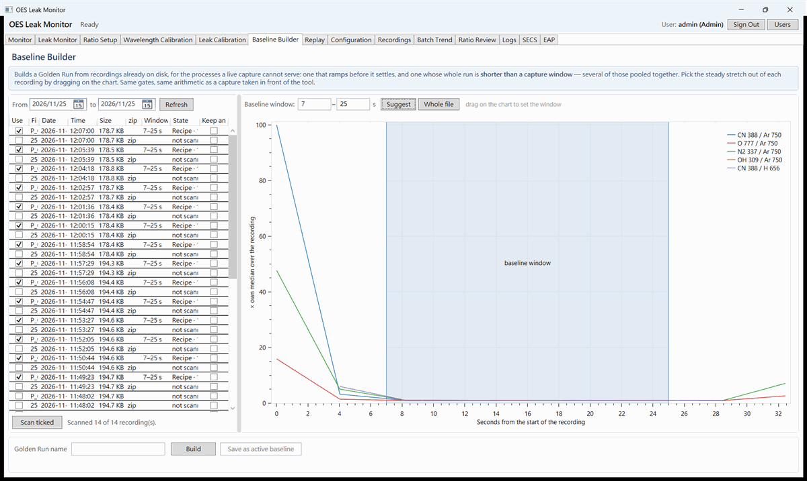
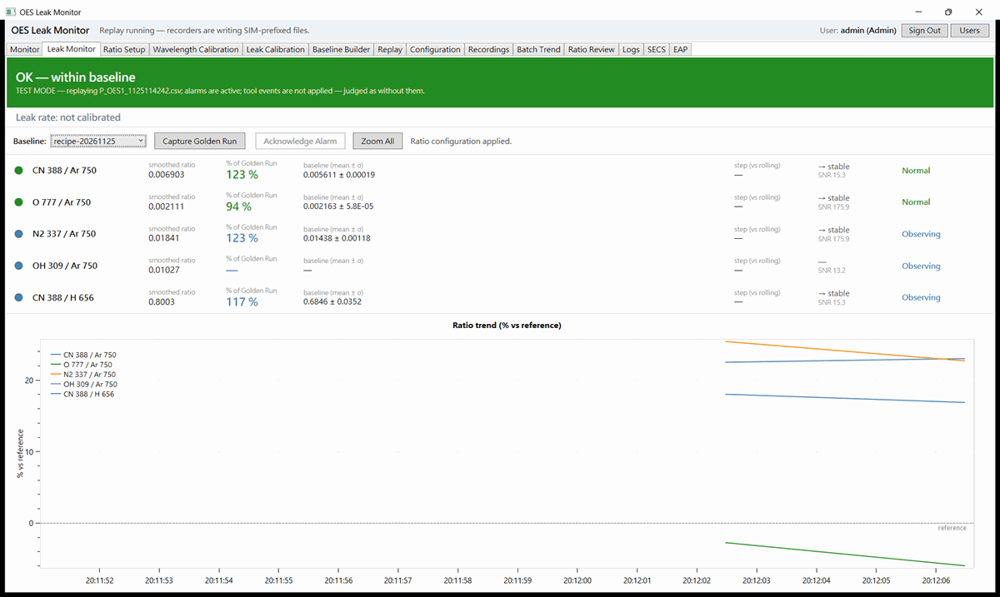
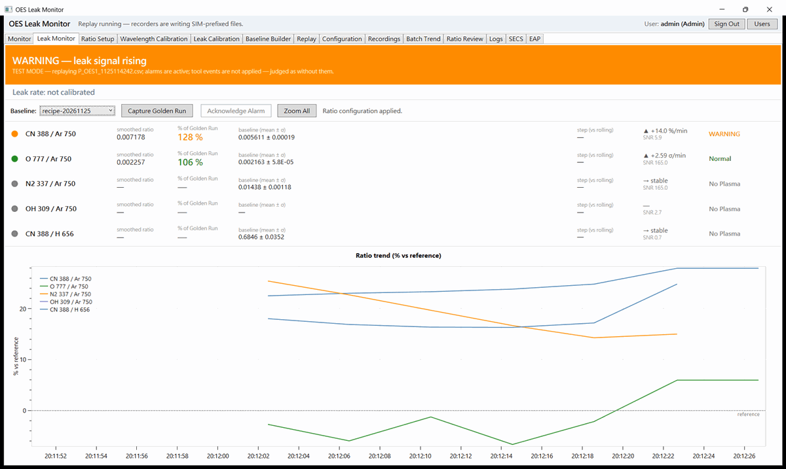
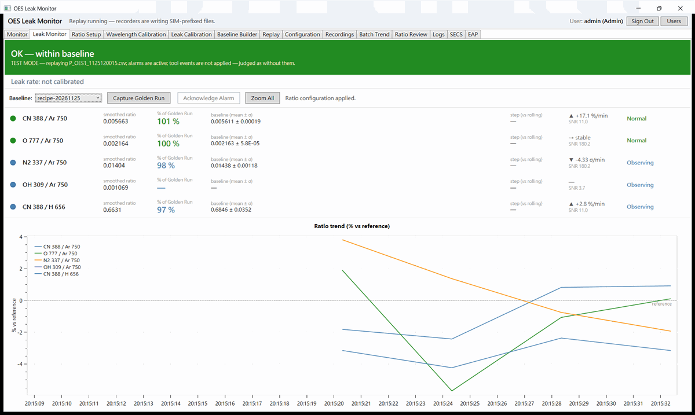
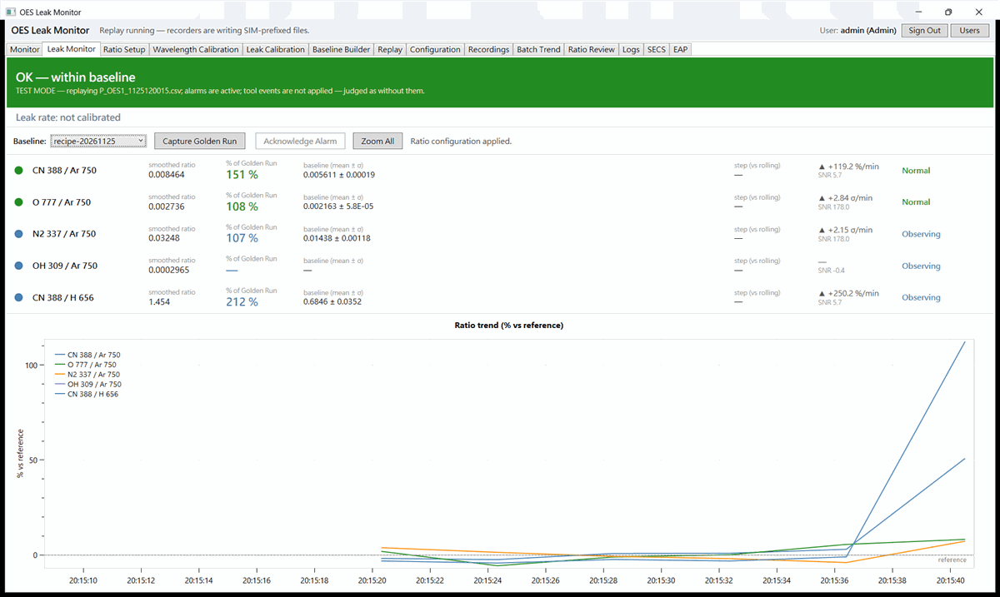

# Replay 驗證 SOP:11/25 新機台的分類器與比值組

目的:上機之前,用 11/25 的錄檔在 App 上重播一次,確認 `production-20261125-precoat-recipe-leak-strategy-zh-TW.md` §5 的分類器與比值組會照預期動作:

- precoat 不判定。
- recipe 每個 step 開頭含 N₂ 的轉換幀不判定。
- 平台區的 step 是 Normal。
- precoat 後的第一個 step 只會讓 CN 單獨 Warning,**不會**變成整體 Alarm。

| 誰 | 何時 | 要多久 |
|---|---|---|
| Engineer(Replay 分頁與 Ratio Setup 要 Engineer 登入) | 機台不跑製程、**光譜儀已斷線**(有接光譜儀時 Play 按不下去) | 約 20 分鐘 |

> 本文的截圖、數字與日誌,是 2026-11-25 在開發機上照本文實際做出來的(App commit `4d4c82b`)。
> 設定一樣,現場做出來的數字應該**相同**;百分比差 1–2 % 是 EMA 起點不同,不算差異。

---

## 0. 重播與上機的設定不一樣

11/25 的錄檔是 `averageCount` 20 錄的,**每幀 4 s**;上機建議改成每幀 1.1 s。有三個值跟幀率或測試模式有關,重播時要用左欄:

| 設定 | 重播(本 SOP) | 上機 | 為什麼 |
|---|---:|---:|---|
| `processClassifier.decideAfterFrames` | **3**(≈ 12 s) | 10(≈ 11 s) | 以幀計。4 s 一幀時設 10 = 40 s,比整個 step 還長,step 永遠判不出類別,什麼都不判定 |
| `logger.saveStartThresholdIntensity` | **2000** | 1000 | 見下方說明 |
| `batch.minWindowFrames` | 3 | 5 | 10–24 s 的窗在 4 s/幀時只有 3–4 幀 |

**觸發門檻為什麼要暫時改成 2000:**

- 測試模式的合成光譜(1000 + 500·sin)每幀 p99 約 1 500,超過現場門檻 1 000。
- 所以按下 Connect → Start 時,引擎就把合成光譜當成一段電漿開了 step,第 3 幀判為 `Unknown`(N₂ / Ar = 1.23)並**鎖定**。
- 按 Play 之後閘門從沒關過,重播的錄檔整段都被當成那個 `Unknown` step,**什麼都不判定**。開發機上第一次就是這樣(§4 的第一列)。
- 改成 2000 之後,合成光譜不會開 step;precoat(p99 約 2 200)與 recipe(5 000 以上)仍會。

代價:11:41:37 那個亮度只有 27 % 的弱 step(p99 1 470–1 730)在 2000 之下不會開 step,**這個 SOP 驗證不到它**(§6)。

---

## 1. 準備(Engineer,App 關閉時做)

1. 備份 `%AppData%\OES_Leak_Monitor\settings.json`,例如複製成 `settings.json.bak-before-replay-20261125`。
2. 用記事本打開 `settings.json`,照 `tools/analysis/20261125/replay-settings-fragment.json` 替換下列鍵,其他保留:
   - `logger.saveStartThresholdIntensity` → `2000`
   - `leakMonitor.requireTwoForAlarm` → `true`
   - `leakMonitor.wavelengthCorrections`:Ar 750.4 +0.4、O 777.2 +0.2(現場已有,確認即可)
   - `leakMonitor.ratios`:下表 5 個(片段檔裡是完整的 JSON)
   - `leakMonitor.processClassifier`:兩條規則,`decideAfterFrames` 3
   - `leakMonitor.batch`:`batchStartClass` `Precoat`、`windowEndSeconds` 24、`minWindowFrames` 3

   分類器在畫面上**沒有設定欄位**,只能改這個檔。

| # | 名稱 | 分子 | 分母 | Process class | Role | Warn / Alarm |
|---|---|---|---|---|---|---|
| 1 | CN 388 / Ar 750 | CN 388.3 `PeakHeight` ±0.6,搜尋 ±1 | Ar 750.4 `Integral` ±1 | Recipe | Alarm | ×1.2 / ×1.3 |
| 2 | O 777 / Ar 750 | O 777.2 `RawMean` ±0.5 | Ar 750.4 `Integral` ±1 | Recipe | Alarm | 3 σ / 6 σ |
| 3 | N2 337 / Ar 750 | N2 336.7 `RawMean` ±0.5 | Ar 750.4 `Integral` ±1 | Recipe | TrendOnly | — |
| 4 | OH 309 / Ar 750 | OH 308.9 `PeakHeight` ±0.5 | Ar 750.4 `Integral` ±1 | Recipe | TrendOnly | — |
| 5 | CN 388 / H 656 | CN 388.3 `PeakHeight` ±0.6 | H 656.3 `PeakHeight` ±0.5 | Recipe | TrendOnly | — |

分類器規則(兩邊都是 `RawMean` ±0.5,**沒有**波長修正,所以直接寫讀值波長):

| 順序 | 規則 | 類別 |
|---|---|---|
| 1 | `N2 336.7 / Ar 750.8 > 5` | Precoat |
| 2 | `N2 336.7 / Ar 750.8 < 0.5` | Recipe |
| — | fallback 空白 | Unknown(不判定) |

3. 確認錄檔都在 `C:\DualOES\202611\25`(或現場的 `D:\OES_LEAK_DATA\202611\25`)。下面用到:
   `P_OES1_1125113613`(precoat)、`P_OES1_1125114242`(precoat 後第 1 步)、`P_OES1_1125120015`(第 15 步,平台),
   以及 GR 用的 `P_OES1_1125114923` 到 `P_OES1_1125120700` 共 14 筆。

---

## 2. 確認 Ratio Setup

4. 開 App,以 Engineer 登入 → **Ratio Setup** 分頁。
   - 左邊清單要剛好是上表 5 個,全部勾選。
   - 點每一個,**Process class** 欄要是 `Recipe`。

---

## 3. 用 Baseline Builder 建 GR

> Baseline Builder 規定至少 **60 幀**。4 s 一幀時每個 step 的穩態只有 5 幀,
> 平台區(第 10–19 步)10 筆只有 50 幀,建不起來,所以這裡用第 6–19 步共 14 筆。
> 上機改成每幀 1.1 s 之後,平台區 5 筆就夠。

5. **Baseline Builder** 分頁 → **From** 與 **to** 都設 `2026/11/25` → **Refresh**。
   - 清單裡每筆會出現兩次:一列是資料夾裡的檔,一列 `zip` 欄寫著 `zip`(`25.zip` 裡的同一筆)。**只勾沒有 zip 的那列。**
6. 在 **Use** 欄勾 11:49:23 到 12:07:00 的 14 筆 → **Scan ticked**(約 20 秒)。
   - 狀態列:`Scanned 14 of 14 recording(s).`
   - **State** 欄:全部是 `Recipe · 10 frames`(12 個也可能是 `11 frames`)。
   - 有任何一筆不是 `Recipe`:**停**,檢查 §1 的分類器規則。
7. 逐筆點選 → **Baseline window** 輸入 `7` 與 `25` → 按 Tab。14 筆的 **Window** 欄都要是 `7–25 s`。
   - 不要按 `Whole file`:0 s 那一幀是 step 開頭含 N₂ 的轉換幀(圖 2 左邊的尖峰,CN 是中位數的 100 倍)。

8. **Golden Run name** 填 `recipe-20261125` → **Build**。
   - 狀態列:`Built 4 baseline(s) from 14 recording(s).`
   - 結果面板:

| 比值 | 應顯示 |
|---|---|
| CN 388 / Ar 750 | `0.00561 ± 0.0001904 (mean/σ 29.5, 70 frames)` |
| O 777 / Ar 750 | `0.00216 ± 5.799E-05 (mean/σ 37.3, 70 frames)` |
| N2 337 / Ar 750 | `0.01438 ± 0.00118 (mean/σ 12.2, 70 frames) << only just clears the floor` |
| CN 388 / H 656 | `0.68464 ± 0.03515 (mean/σ 19.5, 70 frames) << only just clears the floor` |
| OH 309 / Ar 750 | `No baseline for:` … `only 11 usable frames` |

   - **沒有任何一筆被擱置**(清單裡沒有橘底)。
   - `Furthest each recording goes outside its own window`:每一筆都是 `1000–5700 σ on CN 388 / Ar 750 at 0 s`。
     這就是頭幀;它是「不能判定頭幀」的直接證據,不是錯誤。
   - OH 309 沒有基準是預期的:它是 TrendOnly,穩態裡 OH 很弱,大部分幀過不了 SNR 5。
9. 按 **Save as active baseline**。
   - 狀態列:`Golden Run "recipe-20261125" saved and made active.`
   - 這會**取代**現場目前作用中的 GR「Recipe 2」。§7 收尾時決定要不要換回去。

---

## 4. Replay

10. **Monitor** 分頁 → **Connect** → **Start**。
    - 沒接光譜儀時會進測試模式:Logs 有 `Device_TestModeFallback`。
    - 同時會有一筆 `LeakMonitorAcquisitionMismatch`(axis 1896 → 1000):合成光譜的波長軸跟 GR 不同,重播時會換回錄檔的軸,可以忽略。
11. **Replay** 分頁 → **Choose CSV…** → 選檔 → Speed → **Play**。照下表播三筆,每筆播完再播下一筆:

| 順序 | 錄檔 | Speed | 內容 |
|---|---|---|---|
| A | `P_OES1_1125113613.csv`(62 幀,4:07) | 20× | precoat |
| B | `P_OES1_1125114242.csv`(11 幀,0:40) | **1×** | precoat 後第 1 步 |
| C | `P_OES1_1125120015.csv`(10 幀,0:36) | **1×** | 第 15 步(平台) |

    B、C 用 1×,才來得及在播放中切到 **Leak Monitor** 分頁看狀態。**每筆播完,監控會自動重設**(Alarm 也會清掉),所以要在播放中看。

### A. precoat

**預期:**

- **Leak Monitor** 頂端是灰色的 `Idle — waiting for plasma / baseline`。
- 5 個比值全部是 `Not this process`,沒有任何讀值。
- Logs:Play 後不到 1 s(20× 下的第 3 幀)有一筆 `Process step classified as Precoat`,值 `N2 336.7 / Ar 750.8 (RawMean)=52.8`;
  之後沒有任何 `LeakMonitorState` 轉換。
- 如果 Logs 裡寫的是 `could not be classified`(Unknown)而不是 Precoat,畫面看起來**一模一樣**,但那是 §0 的合成光譜問題,不是通過。一定要看 Logs。

### B. precoat 後第 1 步(記憶效應最重的位置)

**預期(1× 播放,從按下 Play 起算):**

| 時間 | Leak Monitor | 說明 |
|---|---|---|
| 0–8 s | 灰色 Idle,比值 `Not this process` | 頭幀(0 s)與第 2 幀還在 `decideAfterFrames` 之內,不判定 |
| 8 s | 綠色 `OK — within baseline`;Logs:`Process step classified as Recipe`,值 `0.0316` | 第 3 幀判為 Recipe |
| 8–24 s | CN 388 / Ar 750 **123 %**(綠),O 777 **94–99 %** | CN 高於基準:precoat 帶進來的氮還沒清掉 |
| 24 s | 頂端轉成橘色 `WARNING — leak signal rising`;CN 那一列 `WARNING`,**128 %** | CN 超過 ×1.2 滿 15 s |
| 到結束 | O 777 最高 **106 %**,仍 `Normal`;**整體不會到 ALARM** | `RequireTwoForAlarm`:只有 CN 一個越線 |

`SIMP_Ratio_*.csv` 的逐幀值(開發機實測):

| 幀 | CN / Ar % of GR | O 777 σ 分數 | OverallState | ProcessClass |
|---:|---:|---:|---|---|
| 1–2 | — | — | Idle | — |
| 3 | 122.5 | 97.3 | Normal | Recipe |
| 4 | 123.0 | 94.0 | Normal | Recipe |
| 5 | 123.3 | 98.7 | Normal | Recipe |
| 6 | 123.8 | 93.3 | Normal | Recipe |
| 7 | 124.8 | 97.8 | **Warning** | Recipe |
| 8 | 127.9 | 106.0 | Warning | Recipe |

O 777 是 `RawMean`,這一欄是 σ 分數(100 = 基準,120 = 高出一個 Warn σ),不是百分比。

> 這是**預期的 Warning**,不是漏氣。上機後每次 precoat 之後的前幾步都會這樣,直到依位置的 GR(#135)做出來。
> 如果現場不想看到它,先把 CN / Ar 的 `WarnFactor` 提高到 1.3–1.4。

### C. 平台區的 step

**預期:**

- 8 s 判為 Recipe(值約 `0.025`)。
- 之後 CN / Ar **98–103 %**,O 777 **94–106**,整體綠色 `OK — within baseline`。
- 最後一幀(尾幀)CN / Ar 衝到約 **151 %**,超過 Alarm 門檻 ×1.3,但只持續一幀(4 s),不滿 `ConfirmSeconds` 15 s,所以**仍是 Normal**。

### 看日誌

12. **Logs** 分頁 → **Refresh**。每次 Play 之後應該有:
    - `ReplayStarted`
    - 約 8 s 後一筆 `LeakMonitorProcessStep`:`Process step classified as Recipe`,Value 欄是 `N2 336.7 / Ar 750.8 (RawMean)=0.02…–0.03…`
    - `LeakMonitorState`:`Idle → Normal`(B 還有 `Normal → Warning`)
    - `ReplayEnded`

---

## 5. 判定

| 看到的 | 原因 | 處理 |
|---|---|---|
| A、B、C 的結果都跟 §4 一樣,且 Logs 分別是 Precoat、Recipe、Recipe | — | **通過**,可以照 §7 上機 |
| 重播 recipe 時 5 個比值一直是 `Not this process`;Logs 有一筆 Play **之前**的 `Process step could not be classified`,值約 `1.2` | 觸發門檻還是 1000,合成光譜開了 step(§0) | 改成 2000,重開 App 再播 |
| `Process step could not be classified`,值在 0.5–5 之間 | 分類時落在頭幀:`decideAfterFrames` 太小 | 確認是 3(重播)/ 10(上機) |
| 一直沒有 `LeakMonitorProcessStep`,recipe 也是 Idle | `decideAfterFrames` 比 step 的幀數還大 | 確認重播時是 3 |
| B 的整體狀態到了 **ALARM** | `requireTwoForAlarm` 沒開,或 O 777 的模式不是 `RawMean` | 回 §1 |
| C 不是 OK | GR 沒有存成作用中,或 §3 的視窗不是 7–25 s | 回 §3 |
| 數字差 1–2 % | EMA 起點不同 | 不用處理 |

---

## 6. 這個 SOP 驗證不到的:弱 step(11:41:37)

precoat 之後的第一個 recipe step 亮度只有 27 %(p99 1 470–1 730),在 §0 的門檻 2000 之下不會開 step。用離線抽線估算它在**現場門檻 1000** 下的情形:

| | 弱 step / 平台 |
|---|---:|
| CN 388 / Ar 750 | ×8.3–10.2 |
| O 777(RawMean)/ Ar 750 | ×1.9–2.3(約 +37 σ) |
| N₂ 336.7 / Ar 750.8(分類值) | 0.023–0.035 → 判為 Recipe |
| Ar 750 積分 | 約平台的 0.27 倍,仍高於 GR 的 plasma floor(平台的 0.2 倍) |

兩個 Alarm 比值都遠超門檻,**整體很可能誤報 Alarm**(要持續 15 s,這個 step 判類別後只剩約 16 s,接近邊緣)。
上機時給 `Recipe` 類別設 `plasmaThreshold` **3000**(觸發指標 p99:弱 step 1 470–1 730、正常 step 5 000–6 700),它就不會被判定。
客戶確認這個 step 是什麼之前,先這樣設。

---

## 7. 收尾,然後上機

13. Monitor 分頁 **Stop**,關 App。
14. 刪除今天日資料夾裡 Replay 寫的檔:`SIMP_*`、Play 之後的 `_config_*`、`_log_*`。
    Connect → Start 時合成光譜觸發的 `P_OES1_*`、`P_Ratio_*`、`P_Batch_*`(時間在本 SOP 開始之後)也要刪。
15. 刪除 `C:\DualOES\_batches.csv`(或現場的資料夾)裡 Replay 新增的批次列。
16. 上機前把 `settings.json` 改成上機值:
    - `logger.saveStartThresholdIntensity` → `1000`
    - `processClassifier.decideAfterFrames` → `10`
    - `processClassifier.classes` 的 `Recipe` → `plasmaThreshold` `3000`(§6)
    - `batch.minWindowFrames` → `5`
    - `devices[0].averageCount` → `5`
17. 改成每幀 1.1 s 之後,`recipe-20261125` 這個 GR 會因取樣不同出現 `LeakMonitorAcquisitionMismatch`。
    錄滿 5 個以上平台 step 之後,照 §3 重建一次 GR(那時 5 筆就超過 60 幀)。
18. 重新連上光譜儀,確認 Monitor 分頁回到即時量測。

---

## 8. 紀錄

把 §3 第 8 步的結果面板(Ctrl+A、Ctrl+C)和 §4 三次 Play 的 Logs 匯出,存成
`_replay_20261125_{今天 yyyyMMdd}.txt`(底線開頭,才不會被列進錄檔清單),附上做的人、日期、與本文不同的地方,交給 Engineer。
